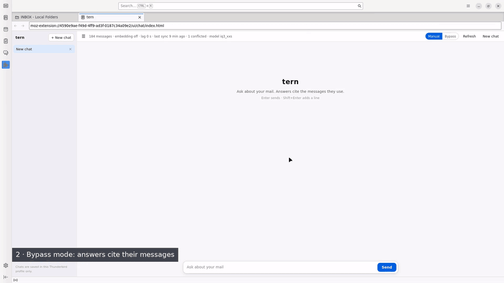

# tern

**A local-first AI assistant for Thunderbird.** tern indexes your mail on your own machine, lets you
chat with it (every answer cites the messages it used), and reads your calendar, contacts and
attachments. All of this runs against a language model on your own computer. Nothing leaves your
machine, and tern never sends mail.



<sub>A synthetic mailbox and a local model. The model's thinking is shown at 6× speed; everything else plays in real time.</sub>

tern has two parts:

- a **Thunderbird MailExtension** (TypeScript), which adds a *tern* tab to Thunderbird and is
  tern's only way to act on mail;
- a **local Python daemon, `ternd`**. It keeps a search index of your mail, runs the chat agent
  and its tools, and serves the same tools to other local AI clients over MCP.

> **Status: alpha.** Linux only, Thunderbird 153 ESR. Reading, searching and chatting work today.
> Tools that change mail (tags, moves, drafts) are on the [roadmap](#roadmap).

---

## Contents

- [Features](#features)
- [How it works](#how-it-works)
- [Requirements](#requirements)
- [Installation](#installation)
- [Configuration](#configuration)
- [Usage](#usage)
- [Security and privacy](#security-and-privacy)
- [Development](#development)
- [Roadmap](#roadmap)
- [Known limitations](#known-limitations)
- [License](#license)

---

## Features

- **Chat with your mail, with citations.** Ask "how much is the Acme invoice and when is it due?"
  and the answer cites its sources as clickable chips. Clicking one opens that message in
  Thunderbird.
- **Reads what Thunderbird knows.** Mail search with unread, starred, folder and date filters;
  threads; contacts and correspondence history; calendars and events, with free slots and meeting
  prep; a daily brief; threads waiting on a reply.
- **Reads attachments.** PDF, Word (`.docx`), Excel (`.xlsx`), text, CSV, HTML and attached
  e-mails.
- **Spoof-aware.** When several different messages share one Message-ID (a common phishing trick),
  tern flags them as *conflicting copies* and never cites them as fact.
- **Per-chat permission modes.** *Manual* asks you before every tool call, with Allow, Deny or
  "Allow all for this turn". *Bypass* runs read-only tools without asking.
- **Saved chats**, Markdown tables, a side panel for long outputs, and Stop at any time.
- **Its own full-text and vector index** of every message, kept current from Thunderbird's events.
  It powers `tern search` and the MCP tools.
- **MCP server** (`tern mcp`): the same audited tools, available to any local MCP client or your
  own agents over stdio.
- **Audit log** of every tool call, viewable with `tern audit`.

## How it works

```
 Thunderbird 153 ESR
 ┌──────────────────────────────┐        native messaging        ┌──────────────────────────────┐
 │ tern MailExtension           │  ◄──────────────────────────►  │ tern-nmhost  (relay)         │
 │  • the tern tab (chat UI)    │                                └──────────────┬───────────────┘
 │  • the only path to mail     │                                               │ Unix socket
 │    actions (open, raw fetch) │                                ┌──────────────▼───────────────┐
 └──────────────────────────────┘                                │ ternd                        │
                                                                 │  • index (SQLite + FTS5 +    │
 Thunderbird profile (read-only snapshot copies) ──────────────► │    sqlite-vec)               │
   GLODA mail index, calendars, address books                    │  • chat agent + tools        │
                                                                 │  • permission engine, audit  │
 Local model server (loopback only) ◄──────────────────────────► │  • MCP over stdio (tern mcp) │
   Strata, or any OpenAI-compatible server                       └──────────────────────────────┘
```

- When Thunderbird loads the extension, it starts `tern-nmhost`, which starts `ternd` if none is
  running. ternd listens only on a Unix socket in your runtime directory and never opens a TCP
  port.
- **The chat agent** mainly uses a vendored copy of
  [thunderbird-mcp](NOTICE) (`tb_*` tools). These read *private snapshot copies* of Thunderbird's
  SQLite databases: the GLODA global search index, calendars and address books. A copy is
  refreshed whenever Thunderbird's database changes, and only ever read, never written.
- **Opening a message and reading an attachment** go through the extension, which fetches the
  message from Thunderbird.
- **tern's own index** is built through the extension: a backfill, then live events, then hourly
  and daily reconciles. It powers `tern search`, citation chips and the MCP tools, and gives
  every message a stable id (`mid`, a hash of its Message-ID). Thunderbird's internal ids are
  never stored.
- **Model requests** go to a local OpenAI-compatible server on loopback. A remote URL is refused
  unless you explicitly allow it.

## Requirements

| What | Version / notes |
|---|---|
| Linux | x86-64. macOS is planned; Windows is not. |
| Thunderbird | **153 ESR**, a tarball install (e.g. `/opt/thunderbird-153/`). Native messaging does not work in the Snap or Flatpak builds. |
| Python | **3.12** |
| [uv](https://docs.astral.sh/uv/) | recommended (`pip` also works, see below) |
| Node.js | **22**, only to build the extension (`.nvmrc`; nvm recommended) |
| `zip` | to package the extension as `tern.xpi` (`make ext-xpi`) |
| A local model server | An OpenAI-compatible chat server on `127.0.0.1` with **tool calling and streaming**. tern is developed and tested on **[Strata](https://github.com/Niko1221/Strata)** (model Qwen3.8-Flash-Next (IQ3_XXS), 512k context). Other servers such as LM Studio work too, but smaller models loop, run slowly or cite poorly. |
| Embedding model | optional, and not used in the tested setup; only tern's own vector search (`tern search`, MCP `search_messages`) uses it |

Python dependencies are declared in `pyproject.toml` and pinned in `uv.lock`. `requirements.txt`
is the same pinned set exported for plain `pip`; regenerate it with `make requirements`. The
extension has no runtime npm dependencies.

## Installation

### 1. Get the code and install the Python package

```sh
git clone <this repository> tern
cd tern

# with uv (recommended): creates .venv with the pinned dependencies and dev tools
uv sync --all-extras

# or with pip
python3.12 -m venv .venv && . .venv/bin/activate
pip install -r requirements.txt
pip install --no-deps .
```

This installs three commands into the virtual environment:

- `tern`: the CLI;
- `ternd`: the daemon;
- `tern-nmhost`: the native-messaging relay Thunderbird starts.

### 2. Install the extension's build tools

```sh
nvm install 22 && nvm use 22      # once
npm --prefix extension ci         # build tools only; the extension has no runtime dependencies
```

The extension itself is built and packaged in [step 5](#5-install-the-extension-in-thunderbird).

### 3. Register the native-messaging host

```sh
uv run tern install-host
```

This writes `~/.mozilla/native-messaging-hosts/tern.json`, which points Thunderbird at your
`tern-nmhost`. Run it again whenever you move the checkout or recreate the virtual environment.

### 4. Configure your model server

Start your model server first. The built-in defaults are the tested setup: Strata serving
Qwen3.8-Flash-Next (IQ3_XXS), with a 512k context on port 47831, no embedding model, no limit on tool calls or answer
time, and a 200k-token tool-output budget. With that setup you need no config file at all. Check
that the server answers and that the model id matches:
`curl -s http://127.0.0.1:47831/v1/models`.

**Other servers.** Create `~/.config/tern/config.toml` (the [Configuration](#configuration)
section lists every key) and set `chat_base_url` to the server's `/v1` URL and `chat_model` to its
model id. With a smaller context window, also set limits, for example for LM Studio with a 32k
context:

```toml
chat_base_url = "http://127.0.0.1:1234/v1"      # LM Studio's default port
chat_model    = "openai/gpt-oss-20b"            # any model id your server serves
agent_max_tool_calls        = 8
agent_turn_timeout_s        = 120
agent_context_budget_tokens = 16000             # about half of a 32k context
```

In LM Studio, load the model with an explicit context length, e.g.
`lms load <model> --context-length 32768`.

### 5. Install the extension in Thunderbird

```sh
make ext-xpi        # builds the extension and packages it as tern.xpi
```

1. Start Thunderbird 153 ESR.
2. Open ≡ → **Add-ons and Themes** → gear icon → **Install Add-on From File…**, pick `tern.xpi`
   and confirm. It stays installed across restarts.
3. A **tern** button appears in the spaces toolbar (the vertical bar on the far left). Click it to
   open the tern tab.

Installing the extension starts `ternd`. The first backfill indexes your folders, newest mail
first, and `tern index status` shows its progress.

- **Updating:** after pulling or changing the code, run `make ext-xpi` again and install the new
  `tern.xpi` the same way. It replaces the old version.
- **If Thunderbird refuses an unsigned add-on:** set `xpinstall.signatures.required` to `false` in
  Settings → General → Config Editor, then install again.
- **For development,** load `extension/dist/manifest.json` as a temporary add-on instead (gear
  icon → Debug Add-ons → Load Temporary Add-on). It is removed when Thunderbird restarts. Don't
  have both installed at once: they share one add-on id.

### Optional: run ternd as a systemd user service

To keep `ternd` running when Thunderbird is closed (for MCP clients, say), install
`packaging/systemd/ternd.service.in`:

1. Replace `@TERN_PYTHON@` with the absolute path of `.venv/bin/python`.
2. Save the result as `~/.config/systemd/user/ternd.service`.
3. Run `systemctl --user daemon-reload && systemctl --user enable --now ternd`.

Only one ternd runs at a time: a second one finds the instance lock held and exits.

## Configuration

tern reads `~/.config/tern/config.toml`. Every key is optional; an unknown key or an invalid value
stops ternd with a clear error. The built-in defaults are the tested Strata setup, so you only
need this file for another server or to change a limit. The keys you are most likely to change:

| Key | Default | Meaning |
|---|---|---|
| `chat_base_url` | `http://127.0.0.1:47831/v1` | OpenAI-compatible chat server (must be loopback) |
| `chat_model` | `iq3_xxs` | chat model id |
| `chat_max_tokens` | `4096` | `max_tokens` per model request (reasoning included) |
| `chat_request_timeout_s` | `120` | per-request timeout |
| `agent_max_tool_calls` | `0` | tool calls per answer; `0` = no limit |
| `agent_turn_timeout_s` | `0` | wall-clock limit per answer; `0` = no limit |
| `agent_context_budget_tokens` | `200000` | tool-output budget per answer. Lower it (e.g. `16000`) for small-context servers. |
| `agent_tools` | *(default chat set)* | which built-in tools the chat may use |
| `embed_base_url` / `embed_model` | `http://127.0.0.1:47831/v1` / *(none)* | embeddings for tern's own vector search (`tern search`, MCP `search_messages`); off unless you set a model. The chat doesn't need them. |
| `tb_profile_dir` | *(auto-detected)* | absolute path of your Thunderbird profile directory |
| `tb_accounts` / `tb_exclude_accounts` | `[]` | limit the chat to (or hide) accounts, by email or server user name |
| `tb_max_output_chars` and other `tb_*` keys | | thunderbird-mcp guardrails (folder scope, history window, calendar privacy); the `tb_guardrails` tool shows the ones in force |
| `backfill_window_days`, `reconcile_interval_s`, `reconcile_daily_s` | `30`, `3600`, `86400` | how tern's own index is filled and kept in sync |
| `allow_remote_llm` + `remote_llm_urls` | `false`, `[]` | the only way to use a non-loopback model URL. The tab then shows a permanent "Remote model" banner. |

### Where tern keeps its files

| What | Default location |
|---|---|
| config | `~/.config/tern/config.toml` |
| index, Thunderbird snapshot copies | `~/.local/share/tern/`, `~/.local/state/tern/` |
| logs (`ternd.log`, JSON) and audit log | `~/.local/state/tern/` |
| Unix socket and instance lock | `$XDG_RUNTIME_DIR/tern/` |

Setting `TERN_HOME=/some/dir` moves all of these under that one directory (`data/`, `state/`,
`run/`, `config/`).

**A separate test setup.** Thunderbird passes its environment on to tern, so the `TERN_HOME` you
start Thunderbird with picks the tern setup. To try tern on a test profile without touching your
real one:

```sh
TERN_HOME=~/tern-test /opt/thunderbird-153/thunderbird --profile ~/tb-test-profile --no-remote
```

Put that setup's config in `~/tern-test/config/config.toml`, and run CLI commands with the same
prefix, e.g. `TERN_HOME=~/tern-test uv run tern index status`. Start Thunderbird without
`TERN_HOME` for your real setup. Both share the one native-host registration.

## Usage

### The tern tab

- **Ask anything about your mail, calendar or contacts.** Answers stream in. Facts carry citation
  chips: click one to open the cited message in Thunderbird.
- **Modes** (top of each chat):
  - *Manual* (the default) shows an approval card before every tool call. The card names the
    tool, its permission tier and its arguments, with **Allow**, **Deny** and **Allow all for
    this turn**.
  - *Bypass* runs read-only tools without asking. Write tools always ask, in every mode.
- **Stop** ends a running answer. Closing the tab also stops it.
- **New chat** starts a fresh conversation. Earlier chats are listed in the sidebar and saved in
  the extension's local storage.
- **Refresh** updates the status line: message count, embedding backlog, sync lag, conflicting
  copies and the model in use.

Questions that work well:

- "What unread mail do I have in my inbox?" / "Triage my unread mail."
- "Who am I still waiting on for a reply?"
- "Give me my daily brief for tomorrow."
- "Find the invoice from Acme in July. How much is it, and what does the attached PDF say about
  payment terms?"
- "What did Robin send me recently?"

### The command line

```sh
tern index status          # index counts, backfill progress, embedding backlog (no content)
tern index rebuild         # move the index aside and start fresh (stop ternd first)
tern search "acme invoice" # hybrid search over tern's index (prints mail content)
tern audit --last 20       # recent tool calls: tool, tier, caller, decision (no content)
tern undo <token>          # undo a write by its undo token
tern tools describe        # every tool with its tier and effects
tern mcp                   # serve the tools to an MCP client over stdio
tern install-host          # (re)write the native-messaging host manifest
```

Run them with `uv run tern …` from the checkout, or activate `.venv`.

### MCP clients

`tern mcp` is a stdio MCP server that forwards every call to the running ternd. That means each
call goes through the same permission engine and audit log as the chat. Register it in your
client's MCP configuration; in LM Studio's `mcp.json`, for example:

```json
{
  "mcpServers": {
    "tern": { "command": "/path/to/tern/.venv/bin/tern", "args": ["mcp"] }
  }
}
```

[docs/mcp-clients.md](docs/mcp-clients.md) has the details. MCP clients cannot approve anything,
undo anything or read the audit log.

### Tools

| Tool | Tier | What it does |
|---|---|---|
| `tb_search`, `tb_get_message`, `tb_thread`, `tb_recent_by_address` | R0 | search and read mail (with unread, starred, folder, date and attachment filters) |
| `tb_folders`, `tb_list_accounts`, `tb_stats` | R0 | folders, accounts and counts |
| `tb_attachments` | R0 | find attachments by file name |
| `tb_awaiting_reply`, `tb_unanswered`, `tb_contact` | R0 | follow-ups and correspondence history |
| `tb_calendars`, `tb_events`, `tb_get_event`, `tb_free_slots`, `tb_meeting_prep`, `tb_daily_brief` | R0 | calendar |
| `tb_guardrails`, `skill` | R0 | the guardrails in force; ready-made workflows (e.g. triage) |
| `read_attachment` | R1 | the text of an attachment (PDF, .docx, .xlsx, text, CSV, HTML, e-mail) |
| `open_in_thunderbird` | R1 | show a message in Thunderbird |
| `search_messages`, `get_message`, `get_thread`, `list_folders`, `find_contacts`, `index_status` | R0 | the same kind of reads over tern's own index (offered to MCP clients) |

The tiers:

- **R0** reads local data only.
- **R1** asks Thunderbird to read or show something.
- **W1–W3** are the planned write tiers. W1 changes are reversible and applied automatically; W2
  and W3 need your approval on a card.

## Security and privacy

- **Local only.** ternd listens on a Unix socket (mode 0600) and never on a TCP port. Model and
  embedding URLs must be loopback unless you set `allow_remote_llm` and list the exact URL. Even
  then, the tab shows a permanent banner.
- **tern never sends mail.**
  - The extension does not request the send permissions.
  - No code references a send API; `make check` enforces this (`ext-guard`).
  - Drafts, when they arrive, are only saved or opened, never sent.
  - ternd never imports `smtplib` or `imaplib`.
- **Read-only access to the profile.** ternd reads Thunderbird's databases only through private
  snapshot copies. The copies are stored with mode 0700/0600 and are never written back. All
  other mail access goes through the extension.
- **Every tool call is permission-checked and audited**, whether it comes from the chat, an MCP
  client or the UI. Logs at INFO and above hold only ids and counts, never subjects, addresses or
  bodies. Accounts and folders appear as short hashes.
- **Mail text is untrusted.** Tool output that contains mail, calendar or contact text is wrapped
  as untrusted before it reaches the model. The system prompt tells the model to treat it as
  data, not instructions. The chat UI renders model output through a strict sanitizer:
  - remote images are removed;
  - links open only after a confirmation that shows the full URL;
  - `javascript:` links are plain text.
- **Spoofed copies.** When several different messages share one Message-ID, tern marks them
  *conflicting* and refuses to cite or act on them. The chat names the conflict instead.
- **Saved chats quote your mail.** They are stored in the extension's local storage inside your
  Thunderbird profile, and nowhere else. Delete a chat from the sidebar to remove it.

## Development

```sh
make setup        # uv sync --all-extras + npm ci in extension/
make check-fast   # ruff + biome + tsc + unit tests (pytest, vitest); about a minute
make check        # everything: lint, pyright, all tests, extension build, no-send guard, smoke test
make smoke        # synthetic mailbox → real ingest/index/search/MCP with a stub embedder and fake LLM
make ext-xpi      # build the extension and package it as tern.xpi
make fmt          # format Python and TypeScript
TERN_HOME=$(mktemp -d) make serve   # run ternd in the foreground on a throwaway home
```

`make smoke` currently shows one expected failure: `evaluate` is not wired yet.

**Tests never touch real mail.** They run with `TERN_HOME` in a temporary directory, against a
synthetic mailbox (`tests/fixtures/synthetic_mailbox/`) produced by
`scripts/gen_synthetic_mailbox.py`. Thunderbird-database tools are tested against synthetic
GLODA profiles (`tern.testing.gloda`). Please keep real addresses, subjects and mail out of
tests, fixtures, logs and commits.

### Repository layout

```
src/tern/
  bridge/     wire protocol, Unix-socket server, native-messaging relay (tern-nmhost)
  daemon/     ternd: startup, chat host, request handlers, status
  index/      ingest (backfill, events, reconcile), MIME parsing, SQLite store, conflicts
  search/     FTS5 + sqlite-vec hybrid search, embedding queue
  llm/        OpenAI-compatible streaming client, runtime shim
  agent/      chat loop, citations, context budget, system prompt
  tools/      tool contract (tern-tool/1), registry, built-in tools, attachments
  tbmcp/      vendored thunderbird-mcp (GLODA, calendar, contacts; snapshot copies)
  perms/      permission engine, approvals, audit log, undo
  mcp/        `tern mcp` stdio server
  testing/    fakes and fixtures for tests and plugins (FakeBridge, FakeLLM, synthetic GLODA)
extension/    the MailExtension (MV3): src/tb/api.ts is the only module that calls messenger.*
contracts/    frozen JSON schemas of the bridge protocol (tern-bridge/1.0–1.2) and tool contract
docs/         architecture.md (design, contracts, threat model), mcp-clients.md
packaging/    native-messaging host and systemd unit templates
evals/        synthetic evaluation sets; configs/eval/ their configs
tests/        mirrors src/; golden files, synthetic fixtures, smoke test
```

### Writing a tool

Every tool follows the `tern-tool/1` contract: a pydantic input and output model, a declared
permission **tier** and **effects**, and the `@tool` decorator. Every call goes through
`Registry.call`, which applies the permission engine and the audit log. Plugins are loaded from
the `tern.tools` entry-point group or from `[plugins] paths` in the config. See `src/tern/tools/`
and [docs/architecture.md](docs/architecture.md) §5.

### Protocol changes

The bridge contract is versioned and frozen: one schema file per version in `contracts/`. Never
edit a frozen schema in place. A change that only adds methods gets a new minor version
(`tern-bridge-1.N.schema.json`); a change or removal of an existing shape needs `tern-bridge/2`.

## Roadmap

- **Write tools with undo.** Tags, flags and read state applied automatically and reversibly
  (W1). Drafts that are saved or opened, never sent. Undo from the tab.
- **Move, archive and delete behind approval cards** (W2/W3), with a permanent red-team suite
  against prompt-injected mail.
- **Daily triage.** A class and suggested actions for each new inbox message; tags applied
  automatically, moves proposed for batch approval.
- **Contacts and extraction.** Read and update address books; turn mail into task and date
  proposals.
- **Evaluation on your own mail.** Q&A and tool-call quality measured against fixed success
  criteria, with reproducible runs.
- **Packaging.** A signed XPI on addons.thunderbird.net, a `tern install` command that sets up
  the daemon unit, native host and config skeleton, and an ESR-upgrade runbook.
- **Plugins.** An authoring guide and test templates, so a new tool takes under an hour.
- **Index freshness and coverage.** Show when Thunderbird's own search index is incomplete or
  behind, and say how fresh the data behind an answer is.
- **Citations across turns.** Let an answer cite messages found earlier in the same chat.
- **Attachments.** OCR for scanned PDFs and images, and more formats (`.odt`, `.pptx`).
- **More model runtimes.** Runtime-specific support (model status, versions, quirks) for llama.cpp,
  Ollama, vLLM and others, beyond the generic OpenAI-compatible client used for Strata today.
- **Calendar writes** (event drafts, `.ics`), **resolving conflicting copies** inside tern, and
  **macOS** support.

## Known limitations

- **Chat answers are only as complete as Thunderbird's global search index (GLODA).** If
  Thunderbird hasn't indexed a folder (for example, mbox files copied into the profile by hand),
  the chat won't find its mail. Rebuilding Thunderbird's index fixes it: close Thunderbird and
  move `global-messages-db.sqlite` out of the profile, and Thunderbird rebuilds it on the next
  start.
- New mail reaches the chat once Thunderbird has indexed it, usually within a minute.
- `read_attachment` extracts text only. Scanned PDFs have none (no OCR yet), and encrypted PDFs
  are reported as such. For IMAP messages Thunderbird has not downloaded, Thunderbird fetches the
  message from the server.
- A citation must name a message found in the same answer. When an answer relies only on earlier
  turns, its citations are removed (`[citation removed]`).
- The extension is unsigned: install it from file (`make ext-xpi`), not from addons.thunderbird.net.
- Linux only, Thunderbird 153 ESR only.

## License

Apache License 2.0; see [LICENSE](LICENSE). `src/tern/tbmcp/` is vendored from thunderbird-mcp
under the MIT license; see [NOTICE](NOTICE).
