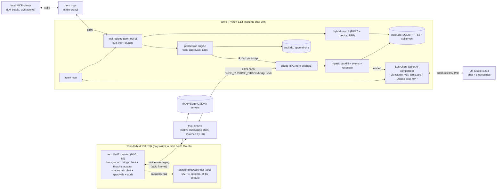

# tern: architecture

tern is a local-first AI layer for Thunderbird. A MailExtension and a local Python daemon give
you chat with your mail (with citations), triage, drafting and filing, served by local models
and exposed as MCP tools. Thunderbird stays the mail client and the only writer to mail.
The decisions behind this are numbered `#N` in `docs/decisions.md`; assumptions are `A-N` in
`docs/assumptions.md`.

## 1. Components



| Component | Lang | Responsibility | Must never |
|---|---|---|---|
| `extension/` | TS | Run mail operations via stable TB APIs (`src/tb/api.ts` is the only module calling `messenger.*` mail APIs), forward mail events, host the chat, approval and audit UI | Call `compose.sendMessage`/`messages.sendMessage` (#8); render model text inside the approval card; load remote resources |
| `tern-nmhost` | Py | Relay native-messaging frames ↔ UDS; start `ternd` if not running | Hold state; parse mail |
| `ternd` | Py | Ingest, index, search, agent loop, tool registry, permission engine, audit, approvals queue | Open TCP listeners (#3); speak IMAP/SMTP (#2); read TB profile files (#2); call non-loopback endpoints unless configured (#9); grant `role=extension` to a peer that fails the peer check (§6) |
| `tern mcp` | Py | MCP server over stdio only (`src/tern/mcp/server.py`: the `mcp` SDK 2.x low-level `mcp.server.Server`, not `MCPServer`, because `MCPServer` derives each tool's input schema from a Python signature and rejects invalid arguments itself, so such a call would never reach `Registry.call` and write its audit row (#10 write-ahead); the low-level `Server` takes the registry's explicit schemas and validates nothing, plan 07, #34). It proxies to `ternd` over the UDS with role `mcp-proxy` (bridge 1.1 `tools.list`/`tools.call`, `src/tern/mcp/proxy.py`, #37), so it uses the same registry, permission engine and audit log; caller `mcp:<proxy connection id>`; it never starts a ternd and exits when ternd drops it (`docs/mcp-clients.md`) | Expose approval decisions or undo; listen on a network transport (no HTTP/SSE/WebSocket transport is configured; `tests/mcp/test_transport.py`); hold its own `Registry` |
| `tern` CLI | Py | `search`, `get`, `chat`, `index status/rebuild`, `audit`, `undo`, `label`, `eval freeze`, `install-host`, `doctor`, `tools describe` | Print mail content at INFO in logs (#11). In a dev session every `tern` command except `--help`, `--version` and `tools describe` runs only with `TERN_HOME` pointing at synthetic data; against real data it is user-run (the guarded-command set is defined once, in #22). Anything the dev session can see (`index status`, `doctor`, INFO logs) shows accounts and folders as stable short hashes, never names or paths (#22) |

**Paths and `TERN_HOME`.** By default tern uses platform dirs: data (index, private evals and runs) under `$XDG_DATA_HOME/tern/`, state (audit log) under `$XDG_STATE_HOME/tern/`, the bridge socket under `$XDG_RUNTIME_DIR/tern/`, config under `$XDG_CONFIG_HOME/tern/`. Setting `TERN_HOME=<dir>` relocates **all four** together: `<dir>/data/`, `<dir>/state/`, `<dir>/run/bridge.sock`, `<dir>/config/config.toml`. Tests, smoke and dev sessions always set `TERN_HOME` to a synthetic location, so they can neither read real data nor talk to the real daemon over its socket (#22).

## 2. Data flows
- **Ingest.**
  1. Backfill: `ternd` pages `mail.messages.page` per folder **by date window, newest window first** (`from_date`/`to_date`), then calls `mail.messages.raw`, parses the MIME, computes `mid` and the per-copy `content_hash`, chunks, writes FTS rows, and queues embedding.
  2. Increments: `event.mail.*` notifications.
  3. Reconcile:
     - hourly, per folder: compares (count, newest date) with TB and, per date window, the set of `header_message_id`s, so equal-count churn is caught; re-pages a window on mismatch;
     - daily: a metadata pass that refreshes tags, flags and read state for every location (events can be missed).
  4. Resumable: `ingest_state` stores a **durable** per-folder watermark (oldest fully ingested window boundary + the set of `mid`s seen at that boundary date). TB's paging cursor is session-scoped, like `tb_id`, and is never persisted (#5).
  5. Throttled: a configurable msgs/s cap, so TB stays responsive (A-1).
  6. Identity conflicts: `conflicted` is recomputed whenever a `mid`'s locations change. It is set when the remaining copies' `content_hash`es differ and cleared when they agree again (e.g. after the user deletes a spoofed copy in TB) (#5, T14).
  7. Known recipients: when a message is ingested into a folder whose `special_use` includes `sent`, its To/Cc addresses (lower-cased) are upserted into `sent_recipients`, counted once per `mid`. Rows are never removed in v1 (§6).
- **Ask (read-only).**
  1. Chat tab → `chat.send` → agent loop.
  2. The loop offers the model the R0/R1 tools only (plan 08a; tools with a forbidden effect are never offered) and runs every tool call the model emits through `Registry.call` as `agent:<session>`, with the whole session's provenance (#35). Each untrusted tool result goes back to the model as JSON inside **one** envelope per result, `<untrusted_email tool="<name>">…</untrusted_email>`, built only by `tern.agent.untrusted.wrap()`; tag-like sequences inside are escaped (T19). A `mid` attribute appears only when a caller wraps the text of a single message; a trusted result (`list_folders`) is plain JSON. A `ToolError` is plain JSON `{"error": {code, reason, message}}`, except from a plugin tool that declares untrusted output, which is wrapped like its results (#35).
  3. The model answers with citations: `[mid]` or `【mid】` as matched pairs (optional inner whitespace and `mid:` prefix; `x-` mids included). A bare mid is not a citation. Since plan 08c the model writes the short id a tool showed (`[a1b2c3d4e5f6]`, `tern.tools.ids`); any reference of 8 to 64 hex digits is accepted in its place (#38).
  4. The daemon validates that every cited reference is a prefix of exactly one indexed mid, that mid is not `conflicted`, and an id returned under a `mid` key by a tool this turn (short or full) is a prefix of it (#38). The raw count of invalid citations is recorded before stripping (eval metric, §9); invalid citations are then stripped and flagged, so the user never sees one. The check runs on the stream: a citation-aware filter holds back a `[`/`【` span until it closes or cannot be a citation (also across a tool call within the turn), and replaces each invalid citation with the fixed marker `[citation removed]`, which is not a citation itself. Valid citations are shown as the model wrote them with the reference replaced by the full mid (so the chat tab's grammar and chips stay full-mid only, #5); `chat.done.citations` lists the surviving mids in order of first appearance. Reasoning text is never forwarded.
  5. Response streamed via `chat.delta`. The user can stop a turn with `chat.cancel`. A turn that does not end `ok` (e.g. `max_tool_calls`, `timeout`, `cancelled`, `llm_unavailable`) ends with `chat.error{reason}` = the outcome code (#35).
  6. A citation chip in the chat tab. Over bridge 1.0 a chip click shows a notice and sends nothing: 1.0 has no extension→daemon method that takes a `mid` (`mail.open` goes daemon→extension and takes a TB message id), so the user asks the assistant to open a cited message, which it does with its R1 open tool through `Registry.call` like any other tool call. From `tern-bridge/1.1` the chip calls `ui.open_mid{mid}`, which ternd serves as `Registry.call("ui", "open_in_thunderbird", {mid})`, audited and engine-checked (§3 planned rows, #36). The tab shows as a chip only text that matches the daemon's citation grammar exactly, and once the turn ends only a mid listed in `chat.done.citations` (a turn that ends with `chat.error` shows none); everything else is plain text.
- **Act.**
  1. The model emits a tool call.
  2. The registry validates input (pydantic).
  3. The permission engine computes the effective tier from the declared tier, declared effects, `count_targets` and, for tools that declare `recipients`, recipient knowledge (§5, §6), and checks the W1 rate windows.
  4. Then by tier:
     - R*: run;
     - W1: run, audit, return an undo token;
     - W2/W3: create an approval (args hash, resolved target headers from the index, provenance list) → `approval.requested` to the extension → user decides → `approvals.decide{approval_id, nonce, decision, subset?}` → re-resolve the targets (§6) → execute exactly the approved args via the bridge.
  5. The result and decision go to the audit log as a call row with status `tb_accepted` (TB took the operation). Reconcile later appends an `observed` event once the index sees the new state (§6, §8); the log is never updated in place.
- **Draft.** `save_draft` (`messages.saveMessage`), then optionally `open_compose`. Both are W1 only when every recipient is known; otherwise W2 (§6). You review and press Send in TB (#8).
- **TB closed.** R0 tools work. R1/W* wait up to 30 s for an extension connection (the extension may be waking, §3), then return `{"error":"unavailable","reason":"thunderbird_not_connected"}`.

## 3. Bridge protocol `tern-bridge/1` (#3)
- **Transport.** Native-messaging framing (u32 length + UTF-8 JSON) between TB and `tern-nmhost`, and the same framing on the UDS.
  - Size limits: the extension→host direction is large (tern caps inbound frames at 64 MiB), but host→extension frames are capped at 1 MiB (TB's `MAX_READ`; S1 measured 1 048 512 bytes ok, 1 048 640 failed). Host→extension frames stay < 512 KiB: `tern-nmhost` splits a larger daemon→extension message into `bridge.chunk` notifications and the extension reassembles them. The daemon sends whole messages over the UDS.
- **Messages.** JSON-RPC 2.0. Both sides send `hello` first:
  - `{protocol:"tern-bridge/1", minor:N, role:"extension"|"daemon"|"mcp-proxy"|"cli", version, capabilities:[...], profile_id?}`. `hello` is a JSON-RPC request; the result is the daemon's own `hello`. `profile_id` is required for `role:"extension"` and absent otherwise. `cli` is the `tern` command line; like `mcp-proxy` it cannot call `approvals.decide`.
  - `profile_id` (extension only) is a random UUID the extension creates on first run and keeps in `storage.local`, so it identifies the TB profile. The index is bound to one `profile_id` (§4); an extension with another `profile_id` is rejected with `profile_mismatch`. S1 measured that `storage.local` survives a TB restart for both the temporary load and the unsigned XPI. If it is ever lost, the user re-binds an index explicitly (user-run); the daemon never re-binds silently.
  - The connection uses `min(minor_e, minor_d)`. A method from a higher minor than negotiated returns `method_not_available`.
  - On a major-protocol mismatch the connection closes with a visible error. A capability change (e.g. the user toggles an optional module) re-sends `hello`; there is no separate toggle method.
  - Capabilities: `mail.read`, `mail.write`, `drafts`, `contacts.read`, `contacts.write`; post-MVP `calendar` (Experiment present and enabled).
- **One extension connection; reconnect and wake (A-24).**
  - At most one `extension` connection is active. When a new extension `hello` arrives while one is active, the daemon sends a liveness ping on the old one: no reply within 2 s → the old connection is closed and the new one wins; a reply → the new one is rejected with `extension_already_connected`. This lets an MV3 background that was suspended and woke up replace its own stale connection.
  - Daemon→extension requests made while no extension is connected wait up to 30 s for a (re)connect, then fail with `unavailable`. They never hang and are never retried silently after that.
  - After any reconnect the extension calls `approvals.pending` to resync the approval UI.
  - The liveness ping is `bridge.ping`. An open native port keeps the MV3 background alive (S1: 30 min idle), so there is no heartbeat. `tern-nmhost` never closes the port when it loses the daemon: it starts `ternd` if the socket is absent, reconnects with backoff, answers extension requests with `unavailable` meanwhile, and on reconnect sends `bridge.reconnected`, after which the extension re-sends `hello` (until then the host forwards only `hello`). The extension registers `runtime.onStartup` at top level (TB does not start an event page with persisted listeners at app startup otherwise) and keeps a 1-minute `alarms` reconnect only while it is unconnected.
- **Versioning (#3, amended).** `tern-bridge/1.0` is frozen in plan 02 as `contracts/tern-bridge-1.0.schema.json` (protected) and contains only the fully specified methods below. Adding methods is allowed as `tern-bridge/1.N`: a new file `contracts/tern-bridge-1.N.schema.json` that is a superset of 1.(N−1), plus a decisions entry. Existing files are never edited. Changing or removing an existing method's shape requires `tern-bridge/2`.
- **Ids.** `tb_id` (TB's runtime message id) and `cursor` (TB's paging id) are valid only within the current connection and are never persisted. Everything persistent uses `mid` (#5).
- **Errors.** Every method can return `unavailable`, `invalid_params`, `method_not_available`. Methods taking a `tb_id` can return `stale_id`: the id is not valid in this connection (issued before a reconnect, or the message was moved or deleted); the daemon re-resolves the `mid` via `mail.messages.find` and retries once, and never persists the id. Write methods can also return `targets_changed` (§6) and `tb_error{code}`. Connection-level errors: `profile_mismatch`, `extension_already_connected`, `role_rejected` (peer check, §6).

**`tern-bridge/1.0` (plan 02 freezes; plan 03 implements the extension side)**

| Direction | Method | Params → Result | Tier |
|---|---|---|---|
| any | `bridge.ping` | `{}` → `{}` (liveness and RTT; either side may send it) | — |
| cli→d | `bridge.ping_extension` | `{n≤10000}` → `{n, p50_ms, p90_ms, p99_ms, max_ms}` (the daemon pings the extension `n` times; `unavailable` with no extension) | — |
| host→e notif | `bridge.chunk` | `{chunk_id, seq, last, data_b64}`: consecutive slices of one serialized message, sent only by `tern-nmhost`, each frame < 512 KiB | — |
| host→e notif | `bridge.reconnected` | `{}`: the host reconnected to `ternd`; the extension re-sends `hello` | — |
| d→e | `mail.accounts.list` | → `[{account_id,name,type,identities:[{identity_id,email,name,is_default}]}]` (identities supply `mail.draft.save{identity_id}`) | R1 |
| d→e | `mail.folders.list` | `{account_id}` → `[{folder_id,path,name,special_use,total,unread}]` | R1 |
| d→e | `mail.messages.page` | `{folder_id, from_date?, to_date?, cursor?}` → `{items:[{tb_id,header_message_id,date,size,flags:{read,flagged,junk},tags,headers_only:bool}],next_cursor?}` (cursor is session-scoped; `from_date`/`to_date` are inclusive, S1; `headers_only` replaces the earlier `offline:bool`, which TB does not expose, S1 NOTES F1) | R1 |
| d→e | `mail.messages.raw` | `{tb_id}` → `{raw_b64}` or error `too_large` (> 25 MB → fall back to `mail.messages.full`) | R1 |
| d→e | `mail.messages.full` | `{tb_id}` → `{headers, text_parts:[{mime,text}], attachments:[{name,mime,size}]}` | R1 |
| d→e | `mail.messages.find` | `{header_message_id}` → `[{tb_id,folder_id,flags,tags}]` | R1 |
| d→e | `mail.open` | `{tb_id}` → `{}` | R1 |
| d→e | `mail.tags.list` | `{}` → `[{key,tag,color}]` | R1 |
| d→e | `mail.tags.create` | `{tag,color?}` → `{key}` (TB requires a tag to exist before it can be set) | W1 |
| d→e | `mail.update` | `{tb_ids,add_tags?,remove_tags?,flagged?,read?}` → `{prev_state:[{tb_id,tags,flagged,read}]}` | W1 |
| d→e | `mail.draft.save` | `{identity_id,to:[addr],cc:[addr],subject,body_text,in_reply_to_tb_id?,attachments?:[{name,mime,content_b64}]}` (attachments ≤ 5 MB total) → `{tb_id}` | W1/W2 (§6) |
| d→e | `mail.compose.open` | `{mode:new\|reply\|forward\|draft,ref_tb_id?,details:{to,cc,subject,body_text}}` → `{}` | W1/W2 (§6) |
| d→e | `mail.move` / `mail.archive` | `{tb_ids,dest_folder_id?}` → `{moved:[{tb_id,new_tb_id?}]}` | W2 |
| d→e | `mail.delete` | `{tb_ids}` → `{trashed:[tb_id]}`; moves to Trash only (`deletePermanently:false` hard-coded) | W3 |
| e→d | `chat.send` | `{session_id,text}` → `{turn_id}`, then notifications `chat.delta{turn_id,text}`, `chat.done{turn_id,citations:[mid]}`, `chat.error{turn_id,reason}` | — |
| e→d | `chat.cancel` | `{turn_id}` → `{}` (the turn ends with `chat.error{reason:"cancelled"}`) | — |
| e→d | `approvals.decide` | `{approval_id,nonce,decision:approve\|deny,subset?:[mid]}` → `{status}`; accepted only from a verified `extension` peer (§6) | — |
| e→d | `approvals.pending` | `{}` → `[approval.requested payload]` (resync after reconnect or wake) | — |
| e→d | `search.query` | `{query, filters?:{folder_id?,from?,after?,before?,has_attachment?}, limit≤50}` → same output as `search_messages`; runs through `Registry.call(caller="ui")` | R0 |
| e→d | `index.status` | `{}` → `{messages, locations, conflicted, parse_failed, headers_only, embed_pending, lag_s, last_reconcile, models:{chat,embed,runtime_version}, accounts:[{account_id,name,last_sync}]}` | R0 |
| e→d | `audit.list` | `{since?, limit≤200, caller?}` → `[{audit_id,ts,caller,tool,tier,target_count,decision,status:tb_accepted\|observed\|error,undo_token?,undone}]` (`status` and `undone` are derived from the latest appended event for that call, §6) | R0 |
| e→d | `audit.undo` | `{undo_token}` → `{undone}` or error `state_changed` (§6) | as the original action (contract wording); tern's undo row tier: §6 Undo |
| e→d notif | `event.mail.new` | `{folder_id, items:[page item]}` | — |
| e→d notif | `event.mail.moved` | `{src_folder_id, dst_folder_id, items:[page item]}` | — |
| e→d notif | `event.mail.deleted` | `{folder_id, header_message_ids:[…]}` | — |
| e→d notif | `event.mail.updated` | `{items:[{tb_id,folder_id,header_message_id,flags,tags}]}` | — |
| e→d notif | `event.folder.changed` | `{folder_id}` | — |
| d→e notif | `approval.requested` | `{approval_id,nonce,tool,tier,targets:[{mid,from,subject,date,folder}],args_view,recipients?:[{addr,name,known:bool}],provenance:[{mid,from,subject}],expires_at}` | — |
| d→e notif | `approval.resolved` | `{approval_id,status:approved\|denied\|expired\|targets_changed}` | — |

**`chat.*` and `index.status` as ternd serves them (plan 08b, #36; the 1.0 shapes are unchanged)**
- **Roles.** `chat.send`, `chat.cancel` and `index.status` are served to `extension` and `cli` peers; an `mcp-proxy` peer gets `role_rejected` before anything runs (1.0 declares no roles on them, so the handlers check, as for `audit.undo`).
- **`chat.send` refusals** (a bridge error, no turn started): `unavailable` while `allow_remote_llm` is true, unless the peer is an extension that negotiated 1.1 and read `daemon.info` on that connection (its tab then shows #9's banner; a `cli` peer stays refused, #37), `invalid_params` for text over 8000 characters or while the session's previous turn still runs, `unavailable` when all 8 in-memory sessions are busy (an idle least-recently-used one is evicted otherwise). The `chat.send` response is written before the turn's first `chat.delta`. `chat.cancel` of a turn that already ended is `{}`; of an unknown turn or another peer's turn, `invalid_params`.
- **`index.status` encodings** (each becomes a nullable field in `tern-bridge/2`): `models.embed = ""` means embedding is disabled, and `embed_pending` is then 0; `models.runtime_version = ""` means not reported (ternd does not probe the runtime on this path); `lag_s` is the age in seconds of the oldest TB event ternd received and has not finished applying (0.0 when none), and it does not count an event queued during a reconcile pass while that event waits for the pass, so it can read 0.0 early; `last_reconcile` is the newest `folders.last_reconciled_at` and `accounts[].last_sync` the newest of the account's folders, an explicit `null` when there is none; an account with no name has `name = ""`. `index.status` reads the index directly; it is not a tool call and writes no audit row. Not in 1.0: failed jobs, the embed queue's paused state and stale writes.

**`tern-bridge/1.1` (frozen: `contracts/tern-bridge-1.1.schema.json`; plan 07 part B and plan 08b, #37)**

A superset of 1.0 (every 1.0 shape unchanged). A peer that negotiated 1.0 gets `method_not_available` for these.

| Dir | Method | Params → Result | Tier |
|---|---|---|---|
| mcp→d | `tools.list` | role `mcp-proxy` only; `{}` → `{tools:[ToolMeta]}` (tern-tool/1 documents) minus forbidden-effect tools | — |
| mcp→d | `tools.call` | role `mcp-proxy` only; `{tool, arguments, client_name?}` → `{ok, output?, untrusted_output, call_id?, error?:{code,reason?,message}}`: exactly one of `output`/`error` by `ok`; tool failures are result data, not bridge errors; `tool` is any string (the registry audits a malformed name as `<invalid>`); `client_name` (1..128 printable) is a display label; no undo token; caller `mcp:<connection id>`, assigned by ternd per connection | as the tool called (`Registry.call`) |
| e→d | `audit.status` | any role; `{}` → `{stale_writes, pending_approvals}` (counts only) | — |
| e→d | `ui.open_mid` | role `extension` only; `{mid}` → `{opened: true, folder_id}`; served as `Registry.call("ui", "open_in_thunderbird", {mid})`; tool errors become bridge errors (`unknown_mid`/`invalid_params` → `invalid_params`, `mid_conflicted` → `state_changed`, `denied` → `role_rejected`, any other → `unavailable`), the tern code kept in the message | R1 (as the tool) |
| e→d | `daemon.info` | roles `extension`, `cli`; `{}` → `{remote_llm: bool, chat_model}`; the tab shows #9's persistent banner while `remote_llm` is true | — |

- **`mcp-proxy` peers** may ask only `bridge.ping`, `tools.list`, `tools.call` and `audit.status` (`role_rejected` otherwise, before params or handlers); a `tools.call` still running when its connection closes is cancelled. There is no cancel method: a per-request MCP cancel is not forwarded (`docs/mcp-clients.md`).

**`tern-bridge/1.2` (staged: exported by `tern bridge schema --version 1.2`, staging copy `plans/08c-tern-bridge-1.2.schema.json`; frozen when the user commits `contracts/tern-bridge-1.2.schema.json` and the build's `MINOR` becomes 2; per-chat permission modes, #39)**

A superset of 1.1 (every older shape unchanged; `chat.send` keeps its 1.0 params). A peer that negotiated 1.0 or 1.1 gets `method_not_available` for these.

| Dir | Method | Params → Result | Tier |
|---|---|---|---|
| e→d | `chat.start` | roles `extension`, `cli`; `{session_id, text, mode: manual\|bypass}` → `{turn_id}`; `chat.send` with a mode, refused exactly like it; then the same `chat.delta`/`chat.done`/`chat.error` | — |
| d→e notif | `chat.approval` | `{turn_id, approval_id, nonce, tool, tier, args, expires_at}`: in a `manual` turn, before each tool call runs (R0/R1/W1); `args` are the validated arguments (model-chosen data, shown as text) | — |
| e→d | `chat.approve` | roles `extension`, `cli`; `{turn_id, approval_id, nonce, decision: approve\|deny, rest_of_turn?}` → `{status}` (1.0 `ApprovalDecided`); only for an open approval of a turn of this connection (`invalid_params` otherwise); decided as caller `ui`; `rest_of_turn` (approve only) approves the turn's later calls without a card (each still audited `approved`) | — |

- **What `manual` asks.** Every tool call of the turn below W2 opens an ask approval in the engine's approvals queue (§6): no row while it waits, then the same rows by outcome as a W2/W3 approval (`approved` and the call runs; `denied`/`user_denied`, `timeout`/`expired`, `denied`/`cancelled`), and a refusal reaches the model as an error tool result while the turn goes on. W2/W3 calls keep their own approval (the engine's notifier, plan 12); `bypass` never lifts it (#10's per-action confirmation).

**`tern-bridge/1.3` (frozen: `contracts/tern-bridge-1.3.schema.json`; the chat model picker)**

A superset of 1.2 (every older shape unchanged). A peer below 1.3 gets `method_not_available` for these; the tab then shows no picker.

| Dir | Method | Params → Result | Tier |
|---|---|---|---|
| e→d | `chat.models` | roles `extension`, `cli`; `{}` → `{models:[{key, model, server, label}], selected: key\|null}`: the chat models **loaded** on `chat_base_url` and `chat_extra_base_urls` (`tern.llm.models`; LM Studio's native API says which are loaded, other servers list what they serve; embedding models left out; a server that is down or fails the egress guard is skipped). `selected` is null when the model new turns use is not listed | — |
| e→d | `chat.select_model` | roles `extension`, `cli`; `{key}` → as `chat.models`; a key not among the loaded models → `invalid_params`. ternd-wide until ternd restarts; each turn uses the model selected when it starts. `daemon.info` and `index.status` then name the picked model | — |

The extension's router asks `chat.models` itself after each successful `daemon.info` on a 1.3 session and pushes the list to that tab (a `models` page event); opening the picker's menu asks again.

**Planned 1.N additions (each owned by the plan that needs it; frozen there)**

| Minor | Owner | Method | Params → Result | Tier |
|---|---|---|---|---|
| 1.2 | plan 10 | d→e `contacts.lookup` | `{addresses:[addr]}` → `{in_address_book:[bool]}` (personal address books only; needed for known-recipient checks, §6) | R1 |
| 1.3 | plan 11 | e→d `triage.list` | `{since?, limit≤200}` → `[{suggestion_id,mid,class,confidence,proposed_actions,auto_applied:bool}]` | R0 |
| 1.3 | plan 11 | e→d `triage.feedback` | `{suggestion_id, verdict:accept\|reject\|edit, final_class?}` → `{}` (feeds live acceptance, §9) | — |
| 1.4 | plan 14 | d→e `contacts.search` | `{query, limit≤50}` → `[{contact_id,book_id,name,emails:[addr]}]` | R1 |
| 1.4 | plan 14 | d→e `contacts.upsert` | `{contact_id?, book_id, name?, emails:[addr]}` → `{contact_id, prev?:{name,emails}}` | W3 |
| 1.N | plan 90 (post-MVP) | d→e `calendar.list_events` / `calendar.create_event` | only with the `calendar` capability; `create_event` has **no attendees field** (§6, T16) | R1 / W3 |

**Minors are numbered in freeze order**: the Minor column is a planning order, not a reservation; whichever plan freezes its contract file first takes the next number, and the later rows shift (plan 07 part B froze 1.1 first, so `contacts.lookup` is 1.2, triage 1.3, contacts 1.4). The chat modes staged above (#39) take 1.2 if they freeze first; every planned row then moves up by one. If a later plan needs a method not listed here, it adds it as the next 1.N with a decisions entry; it does not stop the plan. A 1.N may only **add** methods (or add optional notification types); it never changes a 1.0 method's params or result. `mail.draft.save` already carries `attachments` in 1.0, so the post-MVP `.ics` fallback needs no new shape.

## 4. Index schema v1 (#5)
One index file, `index.db` in the data dir (`$XDG_DATA_HOME/tern/`, or `$TERN_HOME/data/`), bound to one TB profile (`profile_mismatch` otherwise). There are no per-profile subdirectories. Derived; `tern index rebuild` recreates it from TB. Migrations live in `src/tern/index/migrations/NNN_*.sql`.

```sql
CREATE TABLE meta(key TEXT PRIMARY KEY, value TEXT);              -- schema_version=1, tb_profile_id
CREATE TABLE accounts(account_id TEXT PRIMARY KEY, name TEXT, type TEXT);
CREATE TABLE folders(folder_id TEXT PRIMARY KEY, account_id TEXT NOT NULL, path TEXT NOT NULL,
  special_use TEXT,                                                -- JSON array
  tb_total INTEGER, last_reconciled_at INTEGER);
CREATE TABLE messages(mid TEXT PRIMARY KEY,                        -- sha256(normalized Message-ID) | 'x-'||sha256(raw header bytes || raw body bytes)
  header_message_id TEXT,                                          -- parsed Message-ID, brackets stripped, case kept; NULL for x- mids (#30)
  thread_id TEXT, date_utc INTEGER, from_addr TEXT, from_name TEXT,
  to_addrs TEXT, cc_addrs TEXT,                                    -- JSON arrays
  subject TEXT, in_reply_to TEXT, refs TEXT,                       -- refs: JSON array
  lang TEXT,                                                       -- NULL in v1 (#30)
  size INTEGER, has_attachments INTEGER,
  body_text TEXT, parse_status TEXT CHECK(parse_status IN ('ok','partial','failed')),
  conflicted INTEGER NOT NULL DEFAULT 0,                           -- copies of this mid disagree (#5, T14)
  content_hash TEXT,                                               -- #30: the copy whose content fills this row
  conflict_class TEXT,                                             -- #30: classify_pair result while conflicted
  indexed_at INTEGER);
CREATE TABLE locations(mid TEXT NOT NULL REFERENCES messages(mid), folder_id TEXT NOT NULL,
  content_hash TEXT NOT NULL,                                      -- sha256(normalized From addr | Date | normalized raw body bytes), see below; 'full-'… over RAW_MAX (#30)
  tags TEXT, flagged INTEGER, read INTEGER,                        -- tags: JSON array, sorted
  tb_date INTEGER NOT NULL,                                        -- #30: TB's item date, epoch s; non-identity
  PRIMARY KEY(mid, folder_id));                                    -- no TB ids, ever
CREATE INDEX locations_folder_date ON locations(folder_id, tb_date);
CREATE TABLE same_folder_copies(mid TEXT NOT NULL REFERENCES messages(mid),
  folder_id TEXT NOT NULL, content_hash TEXT NOT NULL,
  PRIMARY KEY(mid, folder_id, content_hash));                      -- #30: extra copies in one folder whose hash differs from the location row's
CREATE TABLE sent_recipients(addr TEXT PRIMARY KEY, first_seen INTEGER, count INTEGER);
                                                                   -- To/Cc of messages in Sent folders, filled at ingest (§2 step 7; known recipients, §6)
CREATE TABLE sent_counted(mid TEXT PRIMARY KEY);                   -- #30: mids already counted into sent_recipients
CREATE TABLE attachments(mid TEXT, idx INTEGER, filename TEXT, mime TEXT, size INTEGER,
  PRIMARY KEY(mid, idx));                                          -- metadata only in v1
CREATE TABLE chunks(chunk_id INTEGER PRIMARY KEY, mid TEXT NOT NULL, ord INTEGER,
  kind TEXT CHECK(kind IN ('subject','body','attachment_name')), text TEXT,
  fts_text TEXT NOT NULL);                                         -- #30: text folded (NFD, drop Mn, NFC); queries fold the same way
CREATE INDEX chunks_mid ON chunks(mid);
CREATE VIRTUAL TABLE chunks_fts USING fts5(fts_text, content='chunks', content_rowid='chunk_id',
  tokenize='unicode61 remove_diacritics 2');                       -- #30: indexes fts_text (was text)
CREATE TRIGGER chunks_fts_ai AFTER INSERT ON chunks BEGIN
  INSERT INTO chunks_fts(rowid, fts_text) VALUES (new.chunk_id, new.fts_text);
END;
CREATE TRIGGER chunks_fts_ad AFTER DELETE ON chunks BEGIN
  INSERT INTO chunks_fts(chunks_fts, rowid, fts_text) VALUES ('delete', old.chunk_id, old.fts_text);
END;
CREATE TRIGGER chunks_fts_au AFTER UPDATE ON chunks BEGIN
  INSERT INTO chunks_fts(chunks_fts, rowid, fts_text) VALUES ('delete', old.chunk_id, old.fts_text);
  INSERT INTO chunks_fts(rowid, fts_text) VALUES (new.chunk_id, new.fts_text);
END;
CREATE VIRTUAL TABLE chunks_vec USING vec0(chunk_id INTEGER PRIMARY KEY, embedding int8[{dim}]);
                                                                   -- created per embedding model in plan 05 (M9), not by 001_init.sql;
                                                                   -- {dim} from embedding_model at creation time
CREATE TABLE embedding_model(model_id TEXT, dim INTEGER, quant TEXT, created_at INTEGER);
CREATE TABLE ingest_state(folder_id TEXT PRIMARY KEY,              -- '*' = jobs not tied to one folder (#30)
  watermark_date INTEGER,                                          -- oldest fully ingested window boundary
  watermark_mids TEXT,                                             -- JSON: mids seen at watermark_date
  status TEXT,                                                     -- also 'error:<ExceptionType>' (#30)
  updated_at INTEGER);                                             -- no TB cursor (session-scoped)
CREATE TABLE headers_only_items(folder_id TEXT NOT NULL, tb_date INTEGER NOT NULL,
  ordinal INTEGER NOT NULL, mid TEXT,                              -- #30: never fetched; mid = mid_of(hmid) for non-'md5:' ids, else NULL
  PRIMARY KEY(folder_id, tb_date, ordinal));                       -- ordinal: 0-based, page order, per (folder_id, tb_date)
CREATE TABLE skipped_items(folder_id TEXT NOT NULL, tb_date INTEGER NOT NULL,
  ordinal INTEGER NOT NULL, reason TEXT NOT NULL CHECK(reason IN ('large_noid','tb_error')),
  PRIMARY KEY(folder_id, tb_date, ordinal));                       -- #30: over RAW_MAX without a Message-ID, or raw/full gave tb_error
CREATE TABLE ingest_runs(ts INTEGER NOT NULL,                      -- #30: one row per job run, counts only
  kind TEXT NOT NULL CHECK(kind IN ('backfill','hourly','daily','event')),
  folder_id TEXT, account_type TEXT,
  n_msgs INTEGER NOT NULL DEFAULT 0, secs REAL NOT NULL DEFAULT 0,
  concurrency INTEGER, throttle REAL,
  missed INTEGER NOT NULL DEFAULT 0, stale_retries INTEGER NOT NULL DEFAULT 0,
  skipped_large_noid INTEGER NOT NULL DEFAULT 0, md5_ids INTEGER NOT NULL DEFAULT 0,
  x_mid_churn INTEGER NOT NULL DEFAULT 0, hmid_mismatch INTEGER NOT NULL DEFAULT 0,
  unresolved_events INTEGER NOT NULL DEFAULT 0);
CREATE INDEX ingest_runs_ts ON ingest_runs(ts);
```
- **Schema additions (#30, two-way).** `001_init.sql` is this block minus `chunks_vec`; everything beyond #5's tables (`messages.content_hash`/`conflict_class`, `locations.tb_date`, `same_folder_copies`, `sent_counted`, `chunks.fts_text` + FTS triggers, `headers_only_items`, `skipped_items`, `ingest_runs`) is additive and recorded in #30. `tests/index/test_schema.py` executes this block and compares it with the migration: object names, table and index columns, and each CREATE statement's text (CHECKs, FTS5 options, trigger bodies) up to comments and whitespace.
- **Threads.** `thread_id` = the `mid` of the root found via References/In-Reply-To (simplified JWZ). Orphans are their own root. A `thread_id` may be the `mid` of a referenced message that is not indexed (JWZ step 4 keeps an empty root with 2+ children, `tern.index.threads`): compare `thread_id`s by equality only and never resolve one with `get_message` (plan 06a `get_thread`). References are sender-controlled: thread membership is a display aid and never grants trust (e.g. it never makes a recipient "known", §6).
- **Identity conflicts (#5).** Each location stores a `content_hash`. If two copies of one `mid` have different hashes, `messages.conflicted = 1`: the `mid` is never cited, every write tool refuses it (`MidConflicted`), and `index.status` counts it. The flag is recomputed when locations change and clears when the remaining copies agree (§2). The hashes compared are those of `locations ∪ same_folder_copies` (a differing second copy in one folder is kept, not overwritten). `full-` hashes (messages over RAW_MAX, read through `full`) cannot be compared with raw-derived ones, so a mid whose copies mix the two kinds is `conflicted` (unclassified): a spoof padded past RAW_MAX is never left unchecked (#30 amendment 7, as amended).
  - **Content copy.** `messages.content_hash` names the copy whose content fills the row; a differing copy never overwrites it while a location or same-folder copy still holds that hash. When none does, the row is re-filled from a remaining copy that the caller fetched, or, without one, its content is cleared (`content_hash` NULL, chunks/FTS and attachments dropped, counted as `refill_pending`) until the next write of a copy or reconcile's pending-refill pass fills it (#30). Readers must allow an indexed row with no content.
  - **`conflict_class`** is the worst `classify_pair` class seen while the mid stays conflicted (never lowered when a copy goes; cleared with the flag), set only when ingest supplies the raw bytes of both the content copy and the added copy; conflicts without them (incl. any `full-` copy) stay unclassified and are counted as `conflicts_unclassified` (#30).
  - **Normalization before hashing.** From = lower-cased address only (no display name); Date = parsed to UTC epoch seconds; body = the raw body bytes after converting CRLF to LF and undoing mbox `>From ` quoting (one leading `>` removed from lines matching `^>+From `). Copies that differ only in TB-added headers (X-Mozilla-*), line endings or mbox quoting therefore hash the same.
  - **Known limitation (denial of service).** An attacker who knows a real message's Message-ID can make it `conflicted` by sending a copy with different content: the real message then can't be cited or acted on through tern. v1 accepts this: `index.status` shows the conflict count, and the user resolves it in TB (deleting the spoof clears the flag). A resolution action inside tern is post-MVP (`plans/90-post-mvp.md`).
- **Profile binding.** `meta.tb_profile_id` is set by the first extension `hello`; another profile is rejected (§3). Indexing a second profile (e.g. the spike copy or the test profile) uses a different `TERN_HOME` (§1). The test profile holds a real account, so its `TERN_HOME` is `~/tern-private/tern-home-test` (sandbox-denied), never a synthetic location (#24 amendment).
- **Embedder changes.** The vector dimension and quantization come from `embedding_model` when `chunks_vec` is created; changing the embedder creates a new `chunks_vec` and triggers a re-embed job, leaving the FTS rows alone. Quantization in v1: L2-normalize, then sqlite-vec `vec_quantize_int8(v, 'unit')`; the method string is recorded in `embedding_model.quant` (checked against the pinned sqlite-vec in plan 04). Tests and smoke use a stub embedder with its own `dim` through the same code path.
- **Vectors follow chunks (plan 05, #31).** `tern.search.vec` is the only writer of vector state; all its writes go through `Store.transaction()` on the ingest's own connection (in ternd the embed queue runs on the same `Store` and event loop as ingest). Every `Store` connection, read-write and read-only, loads the pinned sqlite-vec (`v0.1.9`, checked at open), because the triggers below make a chunk delete fail with `no such module: vec0` on a connection without it.
  - **Triggers.** `chunks_vec` is created together with two triggers on `chunks`, in one transaction: `chunks_vec_ad` (`AFTER DELETE`) and `chunks_vec_au` (`AFTER UPDATE OF chunk_id, text`) each delete the chunk's vec row. They cover every chunk-delete path (replace with changed chunks, last location removed, content cleared) and future ones. Re-registration drops the triggers first, then the table, so a chunk delete never meets a trigger without its table.
  - **No stale vector on a reused `chunk_id`.** `chunk_id` has no AUTOINCREMENT, so an id can be reused while an embed request is in flight. `vec.insert` re-checks, inside its transaction, that the chunk still has that id and the exact text that was embedded and has no vec row yet; a changed chunk is skipped (it stays pending) and an existing vector is never replaced (vec0 int8 rows are never UPDATEd).
  - **Current model.** The current model is the `embedding_model` row with the largest rowid; older rows stay as history. A change of (model_id, dim, quant) drops and recreates `chunks_vec` with the new `{dim}` (no shadow-table swap: `ALTER TABLE … RENAME` breaks vec0), so every chunk is pending again and vector recall is partial until the re-embed finishes (reported as `embed_pending`); FTS rows are untouched. Inconsistent vector tables (a table or trigger without a model row, another declared dim, an unknown quant) raise `VecStateError` on read; registering the configured model again is the repair path.
  - **Embed state is derived.** Pending = chunks with no vec row (queued newest-first by `messages.date_utc`, then `chunk_id`, read in windows of up to 4096 chunks per scan, so mail ingested meanwhile waits at most one window); `embed_pending` = `count(chunks) − count(chunks_vec)` (exact, since every vec row has its chunk); `truncated` = chunks longer than `embed_max_input_chars` (the queue sends the cut text and counts it, never silently). Nothing marks a chunk failed.
  - **`meta.embed_complete_at`** (epoch s, ASCII digits) is set by the embed queue when pending first reaches 0 for the current model and cleared on re-registration; `tern index status` prints it as `embed complete_at=<YYYY-MM-DDTHH:MM:SSZ>` (UTC, or `-` when it is not set).
  - **Direct writes.** The `Store.connection` rule extends to `chunks_vec`, its two triggers, `embedding_model` and `meta.embed_complete_at`, written only by `tern.search.vec` inside `Store.transaction()`.
- **Chunk volume.** At least one subject and one body chunk per message, so a 100k–500k message corpus means roughly 200k to over 1M chunks (A-19).
- **Rebuild trigger.** `meta.schema_version` > the code's version → refuse to open (fail loudly). Lower → run migrations.

## 5. Tool and plugin contract `tern-tool/1` (#6)
```python
from pydantic import Field
from tern.bridge.protocol import Mid
from tern.tools import BoundaryModel, Effect, Tier, ToolContext, tool

class In(BoundaryModel):
    mids: list[Mid] = Field(min_length=1, max_length=500)
    add: list[str] = []
    remove: list[str] = []

class Out(BoundaryModel):
    changed: int  # no undo_token: the engine records it and returns it on ToolResult (§6)

@tool(name="set_tags", tier=Tier.W1, effects={Effect.MAIL_META},
      untrusted_output=False, count_targets=lambda i: len(i.mids))
async def set_tags(ctx: ToolContext, inp: In) -> Out:
    """Add or remove tags on messages."""
    ...
```
- **Name and description.** `name` is snake_case (`^[a-z][a-z0-9_]{0,63}$`) and globally unique. The docstring becomes the MCP/LLM description, so it must not contain user data.
- **Definition (plan 06a, #32).** `@tool` returns a `ToolSpec` (metadata plus the coroutine as `ToolSpec.impl`) that is **not callable**: the only way to run a tool is `Registry.call`. In/Out come from the `(ctx, inp) -> Out` annotations and must be `BoundaryModel` subclasses (`extra="forbid"`, `hide_input_in_errors=True`); Out is an object model (MCP structured output). `effects` are `Effect` members (the closed set of #6; no network or send effect exists); `untrusted_output` is a required keyword. Definition errors (bad name, missing docstring, not `async def`, wrong In/Out, a `Mid` the registry cannot count, a write tool with no target count) raise `ToolDefinitionError` at decoration time. Audit target mids are the top-level In fields typed `tern.bridge.protocol.Mid` (or a list/set/tuple of it); a `Mid` anywhere else needs an explicit `count_targets`, and every W-tier tool must have a detected mid field or declare `count_targets`. A declared `count_targets` is floored at the number of distinct detected mids: a tool can raise its target count, never lower it.
- **Declared recipients.** A tool whose effect can address mail (drafts, compose) declares `recipients=lambda i: [...]` in `@tool`, returning every To/Cc address the call would use. This is part of `tern-tool/1` and frozen with it in plan 06a. A tool never computes its own tier.
- **Tier escalation.** The engine computes the effective tier as max(declared tier, the tier implied by effects), then:
  - count escalation on **every write tier**: if `count_targets` > 20, W1 → W2 and W2 → W3;
  - recipient escalation: if the tool declares `recipients`, the engine asks its injected `KnownRecipients` provider (`is_known(addr) -> bool`); any unknown address raises the tier to at least W2. The default provider (from plan 06b until plan 10 supplies the real one) is a deny-all stub, so every recipient is unknown and every draft needs a card.
  - Plugins cannot lower any of it. (The `set_tags` example above accepts up to 500 mids; any call with more than 20 becomes a W2 batch approval.)
- **Errors.** Every failure of `Registry.call` is a `ToolError(code, message, reason?)` with `code` one of `invalid_params`, `unknown_tool`, `tier_not_enabled`, `unknown_mid`, `mid_conflicted`, `unavailable`, `internal`, or one of the permission engine's codes (plan 06b) `rate_limited`, `ambiguous_location`, `denied`, `expired`, `targets_changed`, `state_changed`, and `reason` an optional snake_case code (e.g. `not_indexed`, `embedder_unavailable`, `tb_error`). Messages carry field locations and reason codes, never input values or mail text. A tool may raise `invalid_params`, `unknown_mid`, `mid_conflicted`, `unavailable` and `internal`; `unknown_tool`, `tier_not_enabled` and the engine's codes are the registry's and engine's own (a tool raising one is reported as `internal`, reason `bad_code`). Any other exception from a tool is `internal` (only its type name is recorded; it is not chained, because its text may quote content). Bridge errors map as: `unavailable` and `tb_error` → `unavailable`, anything else → `internal`; a request outside the tool's scope (`BridgeScopeError`) → `internal`. Without a permission engine (`ToolRuntime.engine` None) every W-tier call is refused with `tier_not_enabled` (audited; nothing executes); ternd always builds one (plan 06b, §6). Write tools refuse a `conflicted` mid (`mid_conflicted`) and a multi-location mid without an explicit folder (`ambiguous_location`, reporting only the location count; the engine checks both before a W tool runs). Error codes are not part of the frozen `ToolMeta` schema, so adding one is not a `tern-tool/1` contract change.
- **What a tool can reach.** `ToolContext` (a frozen dataclass, built per call by `Registry.call`) exposes only `index` (a `Store` opened read-only; a writable Store is refused), `search` (the shared `SearchService`, #31: built once by ternd in `hybrid` mode over a read-only `Store`), `bridge` (a `ScopedBridge`), `log` (a child logger named after the tool), `config` (`TernConfig`), `clock` (epoch seconds), and `targets` (plan 06b: mid → the tuple of its live `ResolvedLocation(folder_id, tb_id, state)`, resolved by the permission engine from `mail.messages.find` just before a W tool runs; `state` is the audit `TargetState`; the `tb_id` lives in memory for that one call only, #5, and is never returned, logged, audited or put in an undo payload; R0/R1 tools always get an empty mapping), and `state_dir` (plan 08c: the runtime's absolute state dir, ternd's `paths.resolve().state` or a test's/probe's synthetic one, or None; tools that keep local state, the `tb_*` snapshot copies, take it from here, never from the process environment, and are `unavailable` without one). `search` must be built over the context's own `index` (`SearchService.store is index`, else `ToolContextError`; checked once when the `ToolRuntime` is built and on every call). A tool gets no raw sockets, no raw DB write handle, and no subprocess helper.
  - **Scoped bridge.** `ScopedBridge` wraps the extension link (or none, when no extension is attached: an allowed request then fails `unavailable`) and allows only the bridge methods the tool's declared effects imply: `read_live` → `mail.accounts.list`, `mail.folders.list`, `mail.messages.find`, `mail.messages.full`, `mail.messages.raw` (`read_attachment`), `mail.open`, `mail.tags.list`; `read_index` alone → none; the write effects map to their 1.0 methods (`mail_meta` → `mail.update`, `mail.tags.create`; `mail_move` → `mail.move`, `mail.archive`; `mail_delete` → `mail.delete`; `drafts` → `mail.draft.save`, `mail.compose.open`; `contacts_write`/`calendar_write`/`filters_write` → none in 1.0). Anything else raises `BridgeScopeError` before the extension is asked, plugins included (#6: "the contract restricts declared effects"). Plan 06b narrows the write methods to the call's own targets: `mail.update`/`mail.move`/`mail.archive`/`mail.delete` must name only tb_ids of `ctx.targets` and be sent as exactly their 1.0 params model (else `BridgeScopeError` → `internal`, reason `bridge_scope`), and a tool with `mail_meta`/`mail_move`/`mail_delete` gets no `mail.messages.find`, whatever else it declares (draft methods' reference tb_ids are plan 10's).
  - **Search and index rules (plan 06a, #31, #32).** `search_messages` calls `ctx.search` only (never FTS or vector SQL) with conflicted mids dropped; `get_thread` drops conflicted members; `get_message` and `open_in_thunderbird` refuse a conflicted mid (`mid_conflicted`); `find_contacts` counts no conflicted message. NULL `date`/`from`/`subject` stay null in tool outputs (no invented values; bridge 1.0 `SearchHit`'s required fields are mapped by plan 08b). `EmptyQuery` → `invalid_params`; `NoEmbeddingModel`, `ModelMismatch` and embedder errors → `unavailable`; index-state and SQLite errors → `internal`; never a silent FTS-only answer. Each tool's index reads run in one read transaction, never held across an await.
- **Discovery.** Built-ins are registered explicitly (`tern.tools.builtin.BUILTINS`, not entry points); plugins come from entry-point group `tern.tools` (each entry point resolves to a `ToolSpec` or a non-empty list of them) and from `config.toml [plugins] paths = [...]` (absolute paths to `.py` files exporting `TOOLS`; nothing is scanned from a directory). Order: built-ins, entry points, config paths. A duplicate name (a plugin shadowing a built-in included), a path that is missing, relative or not loadable, or an entry point that resolves to anything else fails loudly with `PluginLoadError`, naming the source, never file content. `origin` (`builtin`/`plugin`) is set by discovery, never by the tool. Plugins load at daemon start (a failure stops ternd loudly) and are listed in `index.status`; ternd wiring comes with the first plan that runs tools in ternd (07/08a).
- **Frozen schema.** `contracts/tern-tool-1.schema.json` (protected): the JSON Schema of `ToolMeta`, the metadata document every tool exports via `tern tools describe` (`contract: "tern-tool/1"`, `name`, `description`, `tier`, `effective_tier`, `effects`, `untrusted_output`, `counts_targets`, `declares_recipients`, `input_schema`, `output_schema`, `origin`; all required, no other key). The built-ins' own input/output shapes are not part of it (plan 08a's `toolcalls-v1` pins those). A change in pydantic's generated schema for `ToolMeta` alone is a contract event (#32).
- **`tern tools describe`.** Prints the `ToolMeta` list (sorted by name) of the built-ins and entry-point plugins; `--json-schema` prints the `ToolMeta` JSON Schema. It is exempt from the dev-session guard because it is metadata-only: it never resolves `tern.paths`, never reads `config.toml`, never loads config-path plugins, and never opens the index, the audit DB or a socket.
- **Testing.** `tern.testing` gives a `synthetic_index` fixture, `FakeBridge` (records calls, simulates TB), `FakeLLM` (scripted tool calls and answers served as SSE behind the real `LLMClient`, plan 08a) and the approval drivers `approve_all`/`deny_all`/`scripted` (`tern.testing.approvals`, plan 06b: notifiers that decide through `approvals.decide` as caller `ui`). A plugin test template lives in `docs/plugins.md` (written in plan 13).
- **MCP mapping (plan 07, #34).** `tern mcp` (§1) lists the registry's `ToolMeta` and passes every call, an unlisted name included, to `Registry.call` with caller `mcp:<id>` and the client's `clientInfo.name` as `caller_label` (kept only when it is 1..128 printable characters, else null; display only, §6):
  - **Annotations** come from the static effective tier: R0/R1 → `readOnlyHint=True`; W1 → `readOnlyHint=False`, `destructiveHint=False`; W2/W3 → `destructiveHint=True`; `openWorldHint=False` for every tool (local mail only). Count and recipient escalation happen per call and are not reflected.
  - **Untrusted results.** A tool with `untrusted_output` is listed without an `output_schema`, and its results are text only (no `structured_content`), with `_meta {"tern/untrusted_output": true}` on the listing and on each result; the server `instructions` tell the client's model that such results hold third-party email text to treat as data. The text is the result's JSON wrapped by `untrusted.wrap()` in one `<untrusted_email>` envelope with no attribute (`ToolOutcome` carries no tool name; plan 08a, #35), so a mail cannot close the envelope (T19). A trusted tool's result is `structured_content` (and its `output_schema` is listed) plus the same JSON as text.
  - **Errors.** A `ToolError` is an `is_error=True` result whose text is `{"error": {"code", "reason", "message"}}` (the contract's content-free fields; `reason` null when absent), never structured content. Argument validation is the registry's, not the SDK's, so invalid arguments are audited (`invalid_params`).
  - **Forbidden-effect filter.** Tools whose effects intersect `FORBIDDEN_EFFECTS` (`filters_write`) are left out of the MCP tool list; calling one by name is still refused (`denied`/`forbidden_effect`) and audited by the engine, the backstop.
  - **W2/W3 calls** keep the MCP request open while `Registry.call` awaits the decision (no immediate "pending" result); until plan 12 attaches the approval UI they are `unavailable` at once (§6). In process (`RegistryBackend`), a client-side cancel cancels the call (the row gets its `error` event); over the bridge (`tern mcp`) only closing the proxy connection cancels its in-flight calls, and a per-request MCP cancel is not forwarded: the ternd call keeps running, and a W2/W3 call stays pending and runs if the user later approves its card (1.1 has no cancel method, #37; `docs/mcp-clients.md`). Undo and `approvals.decide` have no MCP path.

### Default toolset (v1)
| Tool | Tier | Input → Output | untrusted_output |
|---|---|---|---|
| `search_messages` | R0 | `query, folder?, from?, after?, before?, has_attachment?, limit≤50` → `[{mid,date,from,subject,snippet,score,folders}]` | yes |
| `get_message` | R0 | `mid, max_chars≤20000` → headers + body text + attachment names | yes |
| `get_thread` | R0 | `mid` → ordered `[{mid,date,from,subject,snippet}]` | yes |
| `list_folders` | R0 | → `[{folder_id,account,path,unread,total}]` | no |
| `find_contacts` | R0 | `query` → addresses seen in the index with counts (anyone who ever mailed you; **not** the known-recipient set, §6) | yes |
| `index_status` | R0 | → counts, lag, last reconcile, model ids | no |
| `extract_items` | R0 | `mid` → `[{kind:task\|date\|deadline, text, when?}]` (LLM-side; returns structured proposals only) | yes |
| `suggest_triage` | R0 | `since?, limit` → `[{mid, class, confidence, proposed_actions}]`; classifies one message per model prompt (§6, T17) | yes |
| `open_in_thunderbird` | R1 | `mid` → `{opened, folder_id}` (the TB id is used only inside the call: never returned, logged or audited). Stays R1 only if plan 06a's display check confirms that programmatic display sends no read receipt (MDN) and loads no remote content; otherwise it becomes **W2** (T20) | no |
| `read_attachment` | R1 | `mid` (short id or full mid), `name?`, `max_chars≤50000` → `{attachments:[{name,mime,size}], name, status, text, truncated, detail?}`; fetches the message's raw bytes from Thunderbird (`mail.messages.raw`) and extracts text from PDF (pypdf), .docx, .xlsx, text/CSV/HTML and attached e-mails | yes |
| `address_book_search` | R1 | `query` → contacts (plan 14) | yes |
| `set_tags` / `set_flag` / `mark_read` | W1 (≤ 20) / W2 (> 20) | `mids, …` → `{changed}` | no |
| `save_draft` | W1, escalated to W2 by the engine if any declared recipient is unknown (§6) | `to, cc?, subject, body, reply_to_mid?, identity_id?` → `{draft_mid, unknown_recipients:[addr]}`; declares `recipients` = to + cc | yes (addresses and display names are attacker-chosen) |
| `open_compose` | W1, escalated to W2 by the engine if any declared recipient is unknown (§6) | `draft_mid` → `{}`; declares `recipients` = the draft's To/Cc read from the index | no |
| `move_messages` / `archive_messages` | W2 (≤ 20) / W3 (> 20) | `mids, dest_folder_id, source_folder_id?` → `{moved}` (`source_folder_id` required when a mid has > 1 location) | no |
| `delete_messages` | W3 | `mids, folder_id?` → `{trashed}` (to Trash only; `folder_id` required when a mid has > 1 location) | no |
| `upsert_contact` | W3 | contact fields → `{id}`; the card shows the old → new diff of name and addresses (plan 14) | no |
| `tb_list_accounts` / `tb_stats` / `tb_folders` / `tb_guardrails` | R0 | thunderbird-mcp snapshot tools (below) → accounts and timezone / message count and date range / folders with counts / the guardrails in force | no |
| `tb_search` / `tb_recent_by_address` / `tb_get_message` / `tb_thread` / `tb_attachments` / `tb_awaiting_reply` / `tb_unanswered` / `tb_contact` | R0 | thunderbird-mcp snapshot tools (below), upstream's parameters → upstream's result (messages with GLODA `message_id`, `conversation_id`, `header_message_id`, previews, flags) | yes |
| `tb_calendars` / `tb_events` / `tb_get_event` / `tb_free_slots` / `tb_meeting_prep` / `tb_daily_brief` | R0 | thunderbird-mcp snapshot tools (below) → calendars, events (recurrences expanded), free slots and conflicts, meeting prep, daily brief | yes |
| `skill` | R0 | `name` (one of the vendored thunderbird-mcp skills) → `{name, text}` (the skill's `SKILL.md`, shipped with tern) | no |

Built-in outputs are object models (e.g. `search_messages` → `{hits: [...], mode, embed_pending}`, `list_folders` → `{folders: [...]}`); the table gives the main payload. **Write tools return no undo token** (plan 06b, #33): the engine captures each target's prev and post state itself (`mail.messages.find` before and after the tool runs), records the token in the audit log and returns it on `ToolResult.undo_token`, next to the tool's own output. A tool (or plugin) therefore cannot forge undo state, and a token exists only once the write was accepted. Their exact shapes are not part of `tern-tool/1`; plan 08a's `toolcalls-v1` pins them. `open_in_thunderbird` ships as R1 until the display check runs (`docs/integration-checklist.md`, "Plan 06a"); a W2 result changes this table and the tool's metadata together (`tests/tools/test_inventory.py` reads this table).

**thunderbird-mcp snapshot tools** (decision of 2026-11-16, amending #20/#22's "ternd never reads TB profile files"). The `tb_*` tools are the user's thunderbird-mcp tools (MIT, commit 4921d1e), vendored as `tern.tbmcp` and wrapped as built-ins in `tern.tools.builtin.tb` with upstream's names, parameters, defaults and descriptions. They read private, consistent snapshot copies of TB's SQLite databases (GLODA `global-messages-db.sqlite`, the calendar databases, the address books), plus the profile's prefs file for accounts, calendar names and timezone; the profile is `tb_profile_dir`, else the default in TB's `profiles.ini`. The live databases are only ever file-copied, never opened through SQLite; the copies live in `<state dir>/tb-snapshot/` (`0700`/`0600`, `TERN_HOME`-aware). The tools declare `read_index` (R0, no bridge method): no effect names "reads TB's databases" more precisely and the effect set is closed (`tern-tool/1`). Each output is `{result: <upstream's JSON result>}` after upstream's output budget (`tb_max_output_chars`). Upstream's guardrails (scope, history limit, private events, redaction, injection flags) are set from the `tb_*` keys of `config.toml`, never from environment variables, and tern's audit replaces upstream's audit log. Their ids (`message_id`, `conversation_id`, `event_id`) are GLODA/calendar ids, not tern `mid`s. `tern.tools.builtin.CHAT_TOOL_NAMES` lists them with `skill` for the chat agent; tern's own read tools above stay (smoke contracts, `toolcalls-v1`).

Calendar tools (`calendar_list_events` R1 / `calendar_create_event` W3) are post-MVP (#23, `plans/90-post-mvp.md`). Rules fixed now: `calendar_create_event` has no attendees field in v1, because invitations are sent by the calendar server (T16); its card shows title, time, location and full description.

There are no tools for: send, permanent delete, empty Trash/Junk, filter edits (no stable API, and too much persistence for an injection to exploit), account settings, or plugin install.

Multi-location semantics (Gmail labels appear as folders, the same `mid` can sit in INBOX, All Mail and label folders): tag/flag/read apply to every location of the `mid`. Move/archive/delete act on one named location. What "archive" and "delete" mean per account type (Gmail: label removal vs Trash, which strips all labels) is defined and tested in plan 12; undo restores only the state recorded in `prev_state`.

## 6. Permission model (#7) and approvals
- **Enforcement point.** `src/tern/perms/engine.py`. All callers go through `Registry.call(caller, tool, args)`: agent, MCP proxy, jobs, and the extension UI (`caller="ui"`, e.g. `search.query`). `Registry.call` validates the caller (an invalid caller id is a tern bug: `ValueError`, no audit row), resolves the tool, validates the args, computes the tier, appends the audit `call` row and only then runs the tool. The engine (plan 06b, #33) sits behind that same call as `ToolRuntime.engine`; ternd always builds one (`Daemon.engine`, over `Daemon.audit`, a read-only `Store`, the extension link and `time.time`). Without an engine (unit tests of 06a) W1–W3 are refused with `tier_not_enabled`.
- **Engine order (plan 06b, #33).** Every step that refuses writes the call's audit row (decision `denied` or `error`, the `ToolErrorCode` as `reason`) and nothing after it runs:
  1. caller, tool name;
  2. forbidden effects: a tool declaring `filters_write` (`FORBIDDEN_EFFECTS`, T6) → `denied`/`forbidden_effect`, before its args are validated, so no plugin code runs;
  3. args validated, target count (`count_targets` runs once), then the tier: count escalation, then recipient escalation (§5; `KnownRecipients`; at most 100 distinct recipients, else `invalid_params`);
  4. **W1:** the rate window (reserve), target resolution from the index (`unknown_mid` with reason `not_indexed`/`no_message_id`, `mid_conflicted`, `ambiguous_location` for a `mail_move`/`mail_delete` tool on a multi-location mid without `source_folder_id`/`folder_id`), then live through `mail.messages.find` (a resolved (mid, folder) no longer found → `targets_changed`; no extension → `unavailable`); the write-ahead row `auto`/`tb_accepted`; the tool runs with `ctx.targets`; the engine finds the targets again for the post state, records the undo token (one prev/post pair per (mid, folder) location) and returns it on `ToolResult.undo_token`; write status starts watching the call;
  5. **W2/W3:** no approval UI attached (ternd's notifier is None until plan 12) → `denied`/`unavailable` (reason `no_approval_ui`) at once, before any bridge request; otherwise targets are resolved as for W1, the approval opens (at most 5 open per caller, else `denied`/`rate_limited`, reason `pending_cap`) and the call awaits the decision; an approved call re-hashes its args, re-checks its targets and then runs exactly like W1 with the re-check's fresh locations.
  - **A failed write.** A W tool that fails (raises, or returns the wrong output) after its bridge write was accepted gets its `error` event and no post-state find and no undo token. **A failed write may have partly applied: check the message in TB**; it cannot be undone through tern.
- **Callers.** `agent:<session_id>`, `mcp:<proxy connection id>`, `job:<job name>`, `ui`. For MCP the key is the `tern mcp` proxy's UDS connection, assigned by `ternd`; the client's self-declared `clientInfo.name` is recorded alongside for display only, because a client could rotate names. The caller id is the unit for the per-caller rate window and is recorded in the audit log.
- **Tiers** (after escalation, §5).
  - R0/R1: allowed.
  - W1: allowed, audited, every result carries an undo token. **Rate windows:** at most 500 W1 targets per caller per sliding hour, and at most 1000 W1 targets per sliding hour across all callers together. A call that would exceed either is denied (`rate_limited`) and audited. This replaces the old "500 per run" cap, which an MCP client could reset by making one call per "run" (or, with a per-name key, by reconnecting under new names). The window is counted from the audit log (`AuditLog.target_total` over executed calls whose escalated tier is W1, so it survives restarts and a 21-target W2 call is never in it), plus in-memory reservations taken at the check with no await before the row (concurrent calls cannot overshoot); the per-caller window is checked first (reason `caller_window`, then `global_window`); `ui` is not exempt; an audit read failure is `internal`, never "allowed".
  - W2: queued, then batch approval. The UI shows the list and allows approve all, deselect items, or deny.
  - W3: per-action approval.
- **Count escalation.** > 20 targets: W1 → W2, W2 → W3 (§5). Triage tags one message per call, so it never escalates; a model that tries to tag 21+ messages in one call gets a card.
- **Known recipients (drafts).** A recipient is *known* if the address is in a TB personal address book (`contacts.lookup`, bridge 1.1) or in `sent_recipients` (it appeared in To/Cc of a message in a Sent folder, §2). Thread membership, `find_contacts` and the From of received mail never make an address known. `save_draft`/`open_compose` are W1 only if every To/Cc address is known; otherwise W2 with a card listing all recipients (unknown ones highlighted) and the **full** draft body.
  - **Enforcement point.** The engine, not the tool: tools declare `recipients` (§5), and the engine consults the `KnownRecipients` interface. Plan 06b builds the interface and the deny-all default; plan 10 supplies the real provider (`contacts.lookup` ∪ `sent_recipients`) without touching `engine.py`.
- **Approvals (`src/tern/perms/approvals.py`, plan 06b).** In memory only (a ternd restart drops them; nothing executed, so a crash needs no row).
  - **Request.** The card is built from engine-resolved data only: per target location `from`/`subject`/`date`/folder path from the index (nulls stay null), tool, tier, `args_view` (a copy of the validated args), recipients with `known`, the caller, provenance (from + subject per provenance mid, `Registry.call(..., provenance=)`: mids only), `requested_at`/`expires_at`. The engine also stores the args hash, the nonce and the target snapshot (mid → folder ids), calls `notifier.requested(card)` and awaits. **No `call` row exists while an approval is pending**; the row is written when it resolves, and always before anything executes (write-ahead holds). `approvals.pending()` returns the open cards (UI resync).
  - **Decide.** `approvals.decide(approval_id, nonce, decision, subset=None, caller=...)`: only caller `ui` may decide (another caller → refused `denied`/`approval_role`, the approval stays open). A wrong nonce **denies** the approval (`binding_mismatch`). An unknown or already resolved id → `invalid_params`; a decide on an id that expired → `expired`.
  - **Rows by outcome.** Approved → `approved` (then the re-check); user deny → `denied`/`user_denied`; expiry → `timeout`/`expired`; nonce, subset or re-hash mismatch → `denied`/`binding_mismatch`; the caller's task cancelled while pending → `denied`/`cancelled`; ternd shutdown → `denied`/`shutdown` for every open approval (written by `Approvals.shutdown()` before the audit log closes); the notifier unreachable → `error`/`unavailable`; a notifier bug → `error`/`internal`. Every resolution is announced with `notifier.resolved(approval_id, status)` (bridge `approval.resolved`: `approved`, `denied`, `expired`, `targets_changed`).
- **Approval binding.** Each approval stores `sha256(canonical_json({"tool": name, "args": args}))` and a random nonce (`secrets.token_hex(16)`, shown only to the UI). Execution re-hashes the (possibly narrowed) args it is about to run, so any difference means denial (`binding_mismatch`). Approvals expire 10 minutes after the request (`Limits.approval_ttl_s = 600`, inclusive, checked against the engine's clock both by the waiting call's timer and by `decide`) and are denied (`timeout`).
- **Deselect (W2).** `approvals.decide{…, subset}` may name a subset of the original target `mid`s. The engine checks subset ⊆ original targets (a superset, an empty set, any other change, or any subset on a W3 approval → deny, `binding_mismatch`), rebuilds the args with only those targets (only a tool whose mids are all in top-level `Mid` list fields and that has no `count_targets` can be narrowed; the result is re-validated with the In model), and records both hashes in the audit row (`args_sha256` narrowed, `original_args_sha256`). A narrowed approval keeps its approved tier.
- **Execution re-check.** Just before executing an approved W2/W3 action (after the re-hash, before the `approved` row), the engine first reads the index again: a target no longer indexed → `targets_changed` (reason detail `not_indexed`, handled as below); a target that became conflicted while the card was open (e.g. a copy with the same Message-ID but different content arrived) → row `approved`/`mid_conflicted`, not executed, announced `denied` (D1 holds whenever the conflict appears). It then re-resolves every card location (mid, folder id) through `mail.messages.find`. If a location is gone, i.e. the message was moved or deleted or its folder differs from the one shown on the card, the whole action is denied with `targets_changed`: row `approved` with reason `targets_changed`, not executed, a `targets_changed` event, `approval.resolved` `targets_changed`; the agent may ask again. Extra copies in other folders do not count; a target deselected by a subset is not re-checked. Thunderbird unreachable at the re-check → row `approved`/`unavailable`, not executed, announced `denied`. Otherwise the action runs with the re-check's fresh locations (tb_ids, prev state), so nothing executes against state the user did not see.
- **Write status.** TB accepting an operation is not proof the server applied it (offline queue, expired OAuth token). The audit log is **append-only** with two row kinds: a `call` row per tool call (written once, with its decision and, for an executed call, an initial status: `tb_accepted` for a write, `ok` for a read) and `event` rows that reference a call (`observed`, `error`, `undone`, `targets_changed`). The write-status observer appends an `observed` event when the index sees the new state; undo appends `undone`. A call's current status is its latest `observed`/`error` event, or its initial status if none; `undone` is a separate derived flag (bridge 1.0 `AuditEntry` carries `status` and `undone` apart). Nothing is ever updated or deleted.
  - **The observer (`src/tern/perms/write_status.py`, plan 06b).** `WriteStatus.observe` is in the writing Store's `Store.location_observers` (plan 04's hook: every location change from events, backfill and reconcile). Each executed write with an undo token is watched until every changed target reaches its recorded post state: a post location in an indexed folder shows the post tags/flagged/read (plus, for a move between indexed folders, the source location removed); a post location in a folder the index excludes (Trash, Junk) is observed as the source location's removal. Pending writes are kept in memory (one dict lookup per location change), loaded at ternd start from the audit log (executed, still `tb_accepted`, last 7 days), and checked against the index's current state when registered (TB's event may beat the token). A write whose post state equals its prev state (TB reported no change), or whose folders are both unobservable, is not watched. Observer exceptions propagate.
  - **Stale writes.** `write_status.stale_writes` counts executed writes still `tb_accepted` after 24 h; `tern audit` prints it. The bridge-side count (`index.status`) needs `tern-bridge-1.1` and is not cut yet (#33).
- **Audit log (`src/tern/perms/audit.py`, #10, #32).** `audit.db` in tern's state directory (`tern.paths`; `state/` under `TERN_HOME`); dir 0700, file 0600, WAL, `PRAGMA user_version` = schema version. Three `STRICT` tables, insert-only:
  - `calls`: `seq` (integer primary key: insertion order; `list` is newest first), `call_id`, `ts`, `caller`, `caller_label` (MCP client name, display only), `tool` (`<invalid>` when the requested name is not snake_case), `tier` (effective; null for an unknown tool), `decision` (`auto`/`approved`/`denied`/`timeout`/`error`), `reason` (error code), `args_json` (validated args only), `args_sha256` (canonical JSON; null when the raw args are not JSON), `original_args_sha256` (pre-subset hash of a W2 deselect), `target_mids`, `target_count`, `initial_status`;
  - `events`: `event_id`, `call_id`, `ts`, `kind`, `detail_json` (snake_case keys; ints, bools, nulls or short code strings, so no mail sentence fits);
  - `undo_tokens`: `token`, `call_id`, `ts`, `payload_json`; one per executed write, payload = per-target prev/post state (folder id, tag keys, flagged, read), never content; a used token is an `undone` event, not a deletion.
  - **Write-ahead.** Every `Registry.call` appends its `call` row **before** the tool runs, including unknown tools, invalid args and denials; an audit failure means nothing executes (`internal`, reason `audit_failed`). A tool failure or cancellation appends an `error` event. Rows hold tool, tier, caller, decision, mids, counts and codes; no content is stored except the caller's validated args (#10; may include mail-derived text the model copied, e.g. a `search_messages` `from` or a `find_contacts` query: plan 06a Q1). tern never writes what it read from the index or what a tool returned. `BEFORE UPDATE`/`BEFORE DELETE` triggers abort, and a `BEFORE INSERT` trigger refuses a duplicate key (no `INSERT OR REPLACE`). The module has no update or delete API.
- **Approval card content.**
  - Tool name, tier, and for each target the `from/subject/date/folder` resolved **from the index**, not from model text. Destination folder by full path.
  - Draft cards: all recipients with unknown ones highlighted, and the full body. Contact cards: old → new diff. (Post-MVP calendar cards: title, time, location, full description.)
  - Provenance: "while handling this request the assistant read: <from + subject of every untrusted message in this **session's** context>", not just this turn, because earlier turns' mail stays in the model context.
  - Subjects and from-names are attacker-controlled. They render as quoted data in a visually distinct "from the message" style, are length-capped, and can never produce text in the card's own chrome (labels such as "verified" or the tier).
- **Who can approve.** Only a connection with `hello.role == "extension"` may call `approvals.decide`. The MCP proxy role cannot, and MCP clients have no protocol path to it. Behind the bridge, the engine itself accepts a decision only from caller `ui` (`approval_role`).
  - **Peer check (hardening).** `tern-nmhost` is a Python console script, so `/proc/<pid>/exe` of the peer is just the Python interpreter (the same as `tern mcp`'s) and proves nothing. Instead, `role=extension` is accepted only if, for the UDS peer's `SO_PEERCRED` pid: its `/proc/<pid>/cmdline` is the `tern-nmhost` entry point, **and** its parent process's `/proc/<ppid>/exe` is the configured TB binary (`thunderbird_bin` in config, default `/opt/thunderbird-153/thunderbird-bin`). Otherwise the connection is closed with `role_rejected`. One extension connection at a time, with the reconnect rule in §3.
  - **Limit, stated plainly:** a process running as your user can still start `tern-nmhost` under TB's process tree, or drive TB itself, so approvals are not a boundary against same-user code (A-21). They are a boundary against mail content, models, MCP clients (over the MCP protocol) and other OS users. The peer check raises the bar for an MCP client that also has a shell tool; it is not a boundary.
- **Undo.** `audit.undo(token)` applies the inverse via the bridge, **only if** the current state of every target equals the post-state recorded at execution; otherwise it fails with `state_changed` and changes nothing (no overwriting of later user changes). Supported for tags, flags, read state, move/archive (back to the recorded source location), and delete-to-Trash (move back; until plan 12 adds a durable Message-ID source, refused `state_changed`/`not_locatable` once the index dropped the message). A draft is undone by deleting it to Trash (plan 10). Gmail label semantics are limited to what `prev_state` captured (plan 12).
  - **`Registry.undo(caller, token)`** (`src/tern/perms/undo.py`, plan 06b). Undo is not a tool: it is never in `tools describe`, the MCP tool list or the agent's tools. **Only caller `ui` may undo**: `tern undo <token>` (bridge `audit.undo` as role `cli`) and the extension's audit view (role `extension`) both reach ternd's handler, which undoes as `ui`; role `mcp-proxy` → `role_rejected`; any other caller → `denied`/`undo_not_allowed` (audited; the token is not read).
  - **State check.** Every target is found live (`mail.messages.find`: the index lags and excludes Trash) and must equal the recorded post state (folder, tags, flagged, read). An unknown token → `invalid_params`; a used one or one another undo is running on → `state_changed`; a target with a null side (a created draft) → `state_changed` (`unsupported_target`); a mid that became conflicted → `mid_conflicted`; a mid the index no longer holds (e.g. after a delete-to-Trash once the index dropped its last location) → `state_changed` (`not_locatable`; plan 12 brings a durable source). Each refusal writes an `error` row and changes nothing.
  - **Inverse.** A write-ahead row (tool `undo`, W2 if any inverse is a move, else W1, `auto`/`tb_accepted`; no approval card and no rate-window check, but its executed W1 rows (an undo with no move) count in `ui`'s window and in the global ceiling, so a large undo can rate-limit other callers' W1 writes for up to an hour; a W2 undo row does not), then per target `mail.update` (tags, flagged, read) before `mail.move` back to the prev folder. On success: an `undone` event on the original call, and the undo call gets its own **redo token** (prev/post swapped), so a second `tern undo` on it re-applies the original write and write status watches the undo like any write.
  - **Partial failure.** TB is not transactional: a bridge failure part-way appends an `error` event (with the count of requests applied) to the undo call and no `undone`; the state may be partly restored.
- **Triage job.** The daily triage job prompts the model with **one message per prompt**; its proposed actions may only target that message's own `mid` (anything else is dropped and audited); it may set tags and flags but never `mark_read`, so an injected mail cannot hide others or itself.

## 7. Threat model (prompt injection first)
**Assets**
- Third-party personal data in mail.
- Mailbox integrity.
- Your sending identity.
- Credentials (held only by TB).
- Your attention: approval fatigue.

**Adversaries**
- (1) Anyone who can send you mail: the primary adversary. Content is attacker-controlled, including headers, HTML, attachments and invites.
- (2) A misbehaving local MCP client or its model, **over the MCP protocol**. If such a client also has a shell tool, it is same-user code (below).
- (3) A buggy plugin.
- (4) The cloud coding agent used for development, as a passive egress path (#20, #22).
- Out of scope: same-user local code, including malware and any local agent that can run shell commands. It could drive TB or `tern-nmhost` directly (A-21). The peer check (§6) raises the bar but is not a boundary.

**Design stance.** Assume the model is fully compromised whenever untrusted content is in context. The security boundary is the permission engine plus the approval UI. Prompt hygiene (delimiters, system prompt) only lowers the attempt rate.

| # | Attack path | Mitigation | Verified by |
|---|---|---|---|
| T1 | Injected mail tells the agent to delete or move mail | W2/W3 approval, delete to Trash only, no empty-trash tool, undo, execution re-check | `tests/perms/test_attacker_cases.py` (plan 06b step 11); `tests/perms/test_gate.py`, `tests/perms/test_recheck.py`, `tests/perms/test_undo_state.py`; red-team regression suite (plan 12) |
| T2 | Exfiltration by sending mail to the attacker | No send tool (#8); bundle guard greps for `sendMessage`; drafts to unknown recipients need a W2 card with the full body (T15) | `make check` → `ext-guard`; red-team (plan 12) |
| T3 | Exfiltration through chat rendering (markdown image or link with data in the URL) | CSP `default-src 'self'; img-src 'self' data:`; sanitizer drops remote images; links render inert and open only after a click-to-confirm showing the full URL | vitest `extension/test/sanitize.test.ts`; CSP test |
| T4 | Exfiltration through a remote LLM | Loopback-only endpoint validation (#9) | `tests/llm/test_egress_guard.py` |
| T5 | Exfiltration through an MCP client's cloud model | Accepted limitation (A-9); client name in audit; docs | n/a |
| T6 | Persistence (filters, rules, plugins, triage memory) | No filter or plugin tools; the engine refuses any tool declaring `filters_write` at call time (`denied`/`forbidden_effect`, before its args are validated; config-path plugins included); few-shot triage examples come only from your labels, never auto-learned from mail | Tool inventory test: the registry must contain no tool with `filters_write` in v1; `tests/perms/test_attacker_cases.py` (a plugin declaring `filters_write`) |
| T7 | Bulk noise (mass tagging/flagging, mark-all-read) | > 20 targets in one call → W2 card; sliding-hour windows of 500 W1 targets per caller (MCP keyed by proxy connection, not client name) and 1000 across all callers; undo; audit view | `tests/perms/test_escalation.py` (`set_tags` with 21 mids → W2), `tests/perms/test_rate_window.py`, `tests/perms/test_attacker_cases.py` (600 calls on one connection, 1100 over three with rotating names), `tests/perms/test_undo_state.py` |
| T8 | Approval spoofing (model text that looks like an approval, or args that differ from what is shown) | The card renders only engine-resolved data; args hash + nonce binding; model text never inside the card | `tests/perms/test_binding.py`; vitest approval-card test |
| T9 | Hidden instructions (white-on-white HTML, zero-width characters, tiny fonts) | HTML→text drops `display:none`/`visibility:hidden`/zero-size elements, strips zero-width, bidi, soft-hyphen/CGJ/U+180E, tag and supplementary variation-selector characters (U+FE00–U+FE0F kept), also from attachment names; this is hygiene, not the boundary | `tests/index/test_html_to_text.py` |
| T10 | Target confusion (injected mail lists `mid`s of unrelated messages to move) | The approval card shows real resolved headers for every target; count escalation W1 > 20 → W2, W2 > 20 → W3; deselect only to a subset | `tests/perms/test_attacker_cases.py` (plan 06b step 11); `tests/perms/test_binding.py` (subset/superset); `tests/perms/test_escalation.py` |
| T11 | Social engineering in summaries ("pay to IBAN X") | Not technically preventable; citations link to the source; answers that quote external senders carry a sender badge; a spoofed copy of a real message is `conflicted` and never cited (T14) | manual review |
| T12 | Dev-agent egress (Claude Code reading real mail, directly or through tern's own CLI and daemon socket, spike output, logs, or LM Studio's own logs and conversation history) | #20 + #22: sandbox read/write-deny on private dirs, the real bridge socket dir and LM Studio data; `guard_private.py` hook (paths, the guarded tern command set without a synthetic `TERN_HOME`, journal, `lms log`, home-wide search); user-run spike benches and private-set evals; `hide_input_in_errors`; sentinel test | committed hook unit tests in `tests/hooks/` on synthetic payloads (plan 01), incl. the review bypass/false-positive matrices; plan 09 sentinel test extended to spikes and `ternd` |
| T13 | Malicious attachment parsing | No attachment content extraction in v1 (names only); MIME parse wrapped with a size cap (1 MiB text, bounded HTML parse); header fields capped at 8 KiB unfolded and the header block at 256 KiB before the structural parse, structured parses guarded by a per-message work budget, parse off the event loop; part breadth not yet bounded (`plans/90-post-mvp.md` B5); parse failures recorded as `parse_status='failed'`, never crash ingest | `tests/index/test_mime_fuzz.py` (synthetic malformed corpus), `tests/index/test_mime.py` (header bounds) |
| T14 | Identity spoofing: attacker sends mail reusing the Message-ID of a real message (e.g. a fake invoice with another IBAN) | Per-copy `content_hash` (normalized, §4); disagreeing copies make the `mid` `conflicted`: never cited, writes refused, shown in `index.status` (#5). Residual risk accepted in v1: the same trick makes a real message un-citeable (denial of service); the user deletes the spoof in TB, which clears the flag | `tests/index/test_mid_conflict.py` on the fixture's adversarial same-Message-ID pair, plus CRLF/`>From ` variants that must *not* conflict |
| T15 | Draft exfiltration via thread hijack (attacker-set References) or contact poisoning | Known recipient = personal address book ∪ sent-to addresses, never thread membership; enforced by the engine from declared `recipients` via `KnownRecipients` (deny-all until plan 10); unknown → W2 card with recipients + full body; `upsert_contact` W3 with old → new diff | `tests/perms/test_draft_tier.py`; `tests/perms/test_attacker_cases.py` (forged References, contact poisoning) + plan 12 red-team cases for drafts and contacts |
| T16 | Calendar invitations as outbound mail (post-MVP) | Event tool has no attendees field; card shows full description; `ext-guard` also greps `extension/experiments/` for `itip\|MailServices\|nsIMsgSend\|sendMail\|sendMessage` | `make check` → `ext-guard`; schema test in plan 90 |
| T17 | Triage cross-message injection (one mail relabels or hides others) | One message per triage prompt; actions restricted to that `mid`; no `mark_read` in triage | `tests/triage/test_isolation.py`; red-team case (plan 11) |
| T18 | Stale approval (state changed during the 10-minute wait) and undo overwriting later changes | Execution re-check → `targets_changed`; undo only if current state == recorded post-state | `tests/perms/test_recheck.py`, `tests/perms/test_undo_state.py`, `tests/perms/test_expiry.py`, `tests/perms/test_attacker_cases.py` (targets moved after approval) |
| T19 | Delimiter escape (mail text containing `</untrusted_email>`) | `tern.agent.untrusted.wrap()` escapes any occurrence of the delimiter tags inside the wrapped text | `tests/agent/test_untrusted.py` |
| T20 | Side effects of displaying a message (read receipt/MDN, remote content for allow-listed senders) | Plan 06a's user-run display check tests programmatic `mail.open`; if it can trigger either, `open_in_thunderbird` becomes W2 | plan 06a display check |
| T21 | Approval-role spoofing by a local process | MCP has no path to `approvals.decide`; `role=extension` requires a `tern-nmhost` peer whose parent is the configured TB binary, and is single-connection (§3 reconnect rule); same-user code remains out of scope (A-21) | `tests/bridge/test_role_peercred.py` (a peer without a TB parent claiming `extension` → `role_rejected`); `tests/perms/test_attacker_cases.py` (an `mcp-proxy` peer's `approvals.decide` → `role_rejected`; the engine refuses a non-`ui` caller) |

## 8. Failure modes
| Failure | Handling |
|---|---|
| IMAP sync conflicts | TB owns sync. tern never writes IMAP (#2). The index reconciles from TB state hourly (counts + per-window id sets), daily for tags/flags/read, and on `event.folder.changed`. Approved actions re-check targets before executing (§6) |
| OAuth token expiry or revocation; TB offline | TB re-prompts and queues operations. tern records writes as `tb_accepted` until reconcile observes them; `index_status` shows writes not observed after 24 h and "account X last synced > 24 h ago" |
| Huge mailbox (500k+) | Date-windowed paging newest-first, throttled backfill resumable from a durable watermark, embedding queue processed newest-first; FTS works before embeddings finish |
| Same Message-ID, different content (spoofing, or list copies with added footers) | `mid` marked `conflicted`, not cited, writes refused, counted (T14). Line-ending and mbox `>From ` differences are normalized away before hashing (§4). If legitimate conflicts are common (S1 and plan 04 count them by class; #29), #5's revisit trigger applies |
| One `mid` in several folders (Gmail labels) | Metadata writes apply to all locations; move/delete need an explicit folder (`AmbiguousLocation`); per-account-type semantics in plan 12 |
| Extension background suspended / native port dropped (MV3 event page) | A-24, measured in S1. The extension re-opens the port on wake and re-sends `hello`; the newer connection replaces a stale one after a failed 2 s liveness ping (§3); daemon→extension requests wait up to 30 s for a connection, then fail with `unavailable`; the UI resyncs approvals with `approvals.pending` |
| A second TB profile (e.g. the spike copy) connects | Index bound to one `tb_profile_id`; the other is rejected with `profile_mismatch`; a second profile is indexed only under a different `TERN_HOME` |
| `profile_id` lost (temporary add-on load clears `storage.local`) | `profile_mismatch`, visible; the user re-binds explicitly; never silent. S1 checks whether the chosen install route loses it |
| Huge messages and attachments | `raw` capped at 25 MB → `full` text parts only; attachments are metadata only in v1 |
| Encodings and broken MIME | stdlib `email` with `policy.default`; unknown charset → decode with replacement and `parse_status='partial'`; never drop a message silently (counted in `index_status`) |
| Embedder unreachable / model mismatch | Loud error, never a silent FTS-only answer. ternd's embed queue backs off (1 s → 300 s) with status `unavailable:<Type>` and keeps ingesting; a malformed response stops the queue (`error:<Type>`, logged) while ingest continues; chunks stay pending, never marked failed. A hybrid search with the embedder down, no registered model, or a configured model other than the registered one fails (`tern search`: exit 1 for an unreachable embedder or a model mismatch, exit 2 with the hint `--fts-only` when no model is configured or registered); FTS-only is an explicit mode (`tern search --fts-only`) that every output labels (`mode: fts-only`). `embed_pending` is reported with every result (#31) |
| GPU OOM | One chat model and one embedder; the embed scheduler pauses during each chat model request (`hold("chat")`; an in-flight batch finishes; tool calls between the requests are not held) (A-8); context budgeter caps one turn's retrieved text at a configurable token budget (default 16k; earlier turns' tool outputs are dropped, nothing already sent is rewritten, #38) |
| Daemon RAM | Streaming parse; no whole-folder lists in memory; RSS budget 8 GB checked at the first real install (plan 08b step 7) |
| LLM latency or timeouts | Streaming; 120 s per-turn timeout (`agent_turn_timeout_s`, S3's cap, #35) with a visible error (`chat.error` reason `timeout`); no silent fallback to another model |
| Model or runtime drift | Model id, quant, context and runtime version pinned in config and recorded in every eval's `metrics.json`; `tern doctor` records the LM Studio runtime version and reports a change since the last eval run (LM Studio updates runtimes on its own); re-run the frozen `toolcalls`, `qa` and `triage` evals on any change (`make exp`) |
| TB API breakage on upgrade | All mail API calls go through `extension/src/tb/api.ts`; capability and minor-version negotiation in `hello`; the calendar Experiment is optional and post-MVP; on a new ESR beta, run `make check` + a manual acceptance checklist on a test profile before upgrading |
| TB closed | R0 works; R1/W* fail with `unavailable`; the chat tab is closed anyway |
| Daemon crash | systemd `Restart=on-failure`; nmhost reconnects with backoff; the extension shows a status badge |
| Index corruption or schema mismatch | Refuse to open, with a clear error; `tern index rebuild` |
| Native-messaging host not installed / Snap TB | The extension shows a setup page with `tern install-host` and the unsupported-packaging message |

## 9. Success criteria → verification
| Brief criterion | Measurable form | Where checked |
|---|---|---|
| Day-to-day mail at least as good as current TB | TB remains the client (#1). Manual acceptance checklist `docs/acceptance.md`: 3 accounts sync, filters fire, tags, CalDAV/M365 calendar, contacts sync — all unchanged with tern installed | plan 08b acceptance; repeated on every ESR port |
| Chat over ~10 years / 5–20 GB with cited messages | `coverage` ≥ 0.99; on private `qa-v1` (~100 Qs): `citation_hit_rate` ≥ 0.8, `citation_precision` ≥ 0.5, `recall_at_10` ≥ 0.8; `answer_correct_rate` and `raw_invalid_citation_rate` reported (no gate in v1); invalid citations shown to the user = 0 (invariant, tested) | `make exp` with `qa` config (plan 09); smoke `reference_case` on synthetic |
| Latency | `latency_first_token_p90` < 3 s and `latency_total_p90` < 20 s over `qa-v1`, on the RTX 3090 | Same run |
| Triage ≥ 70 % | `label_agreement` ≥ 0.70 on frozen private `triage-v1` (300), **and** `live_acceptance` ≥ 0.70 over 2 weeks of use with a persistent install | `make exp` with `triage` config (plan 11); live metric from `triage.feedback` (plan 11) |
| Default MCP toolset | All tools in §5 present and described by `tern tools describe`; MCP round-trip smoke | `make smoke` (`api_*` contract); `tests/mcp/` |
| Reliable tool calling | Frozen `toolcalls-v1` (from S3's tasks): ≥ 18/20 tasks with valid arguments, mean over 3 repeats; re-run on any model/runtime change | `make exp` with `configs/eval/toolcalls.toml` (plan 08a) |
| New tool in < 1 h | Following `docs/plugins.md`, you build the example plugin with tests passing in < 60 min (timed once) | plan 13 acceptance |
| Zero egress unless configured | No TCP listener (test asserts daemon sockets are UDS only); loopback guard on LLM URLs; CSP; no telemetry code; dev-agent guard | `tests/daemon/test_no_tcp.py`, `tests/llm/test_egress_guard.py`, `make diff-check` patterns, `guard_private.py` |

### 9a. Metric definitions (frozen with the eval sets in plan 09)
All proportions are reported with a Wilson 95 % CI; p90 latencies with a bootstrap 95 % CI. Pass/fail is judged on the point estimate; the CI is always shown next to it. Model calls use temperature 0 and a fixed seed recorded in the run. Every `metrics.json` carries the provenance fields listed once in #21. Runs on private sets are user-run (#21, #22).
- `coverage` = distinct `mid`s indexed with `parse_status` ok/partial ÷ distinct `header_message_id`s reported by TB across all folders (so Gmail label duplicates count once). Messages whose body TB cannot provide offline are excluded from the numerator and reported as `headers_only`.
- `recall_at_10` = per item, the fraction of its expected `mid`s that appear in the top 10 of `search_messages` with the question as the query; averaged over items.
- `citation_hit_rate` = fraction of items whose final answer cites ≥ 1 expected `mid`.
- `citation_precision` = cited `mid`s that are in the item's expected set ÷ all cited `mid`s, pooled over items. It is a lower bound (unlabelled relevant messages count as misses) and stops "cite everything" from gaming the hit rate.
- `raw_invalid_citation_rate` = citations in the model's raw output that were not returned by a tool this turn (or are `conflicted`) ÷ all raw citations, measured **before** stripping.
- `answer_correct_rate` = fraction of items the user grades correct against the reference answer, in `tern label` review on the private per-item outputs. Reported, not gated, in v1.
- `latency_first_token` = time from the daemon receiving `chat.send` to the first `chat.delta` carrying user-visible answer text (tool calls and reasoning tokens come before it and are included in the wait). `latency_total` = until `chat.done`.
- `label_agreement` = fraction of `triage-v1` items where the predicted class equals the user's label.
- `live_acceptance` = accepted ÷ (accepted + rejected + edited) over triage suggestions the user reviewed in the triage view (`triage.feedback`). Auto-applied tags appear in the same view (keep = accept, undo = reject). Suggestions never reviewed are excluded, and their count is reported next to the rate.
- `toolcall_success` = tasks with a valid tool call sequence and valid arguments ÷ 20, mean over 3 repeats.

## 10. Repository layout (target)
```
src/tern/      bridge/ daemon/ index/ search/ llm/ agent/ tools/ perms/ mcp/ triage/ eval/ testing/ cli.py
extension/     manifest.json  src/{background,tb,ui}/  experiments/calendar/ (post-MVP)  test/
contracts/     tern-bridge-1.0.schema.json (+ 1.N)  tern-tool-1.schema.json   (protected)
configs/       eval/{qa,triage,toolcalls}.toml
evals/synthetic/  qa-v1.jsonl triage-v1.jsonl toolcalls-v1.jsonl injections-v1/ smoke_script.json  (protected)
examples/      example plugin (plan 13)
tests/         unit tests mirror src/; fixtures/synthetic_mailbox/ (generated, protected); golden/ (protected); smoke/
scripts/       gen_synthetic_mailbox.py check_diff.py run_experiment.py make_tables.py
packaging/     systemd/ternd.service  nmhost/tern.json.in
spikes/        throwaway spike code + REPORT.md
```

## 11. Out of scope (v1)
- Our own IMAP/SMTP/MIME-rendering/OpenPGP/calendar stack.
- Post-MVP (#23, `plans/90-post-mvp.md`): calendar tools and the calendar Experiment, the llama.cpp and Ollama runtime shims, gpt-oss-120b evaluation, an in-tern action to resolve `conflicted` messages.
- Calendar events with attendees (invitations are outbound mail).
- Mobile.
- A hosted or multi-user service.
- Fine-tuning.
- Windows.
- macOS (later milestone, #14).
- Agent-initiated sending.
- Filter editing.
- Attachment content extraction (PDF/OCR).
- Indexing encrypted mail.
- Remote models by default.
- Cloud MCP clients.
- Guarantees on TB's Release channel.
- Plugin sandboxing.
- Writes while TB is closed.
